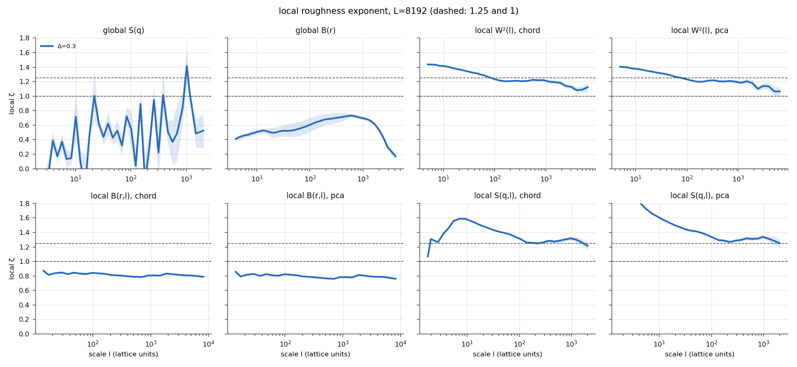
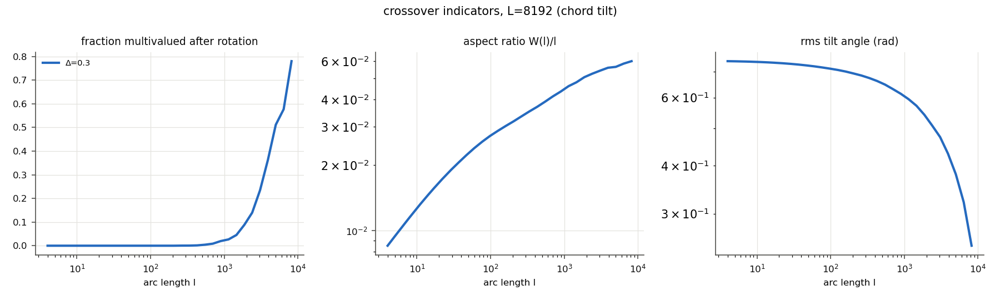
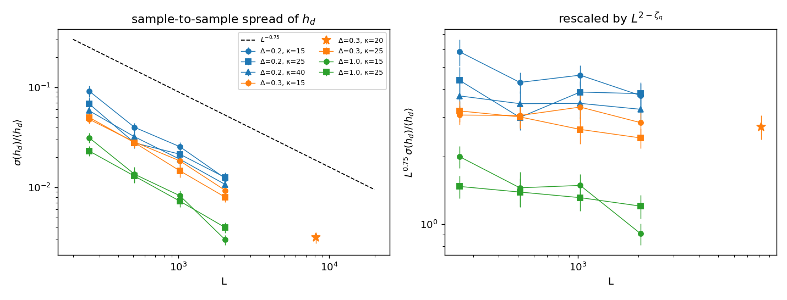
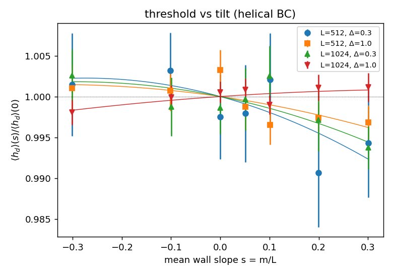
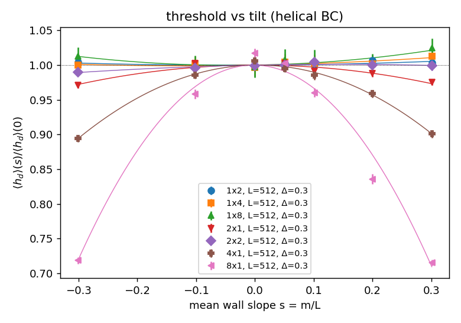
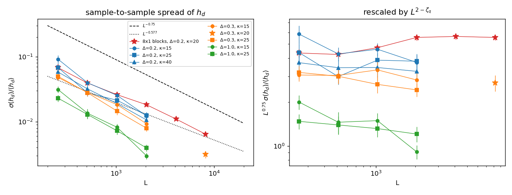
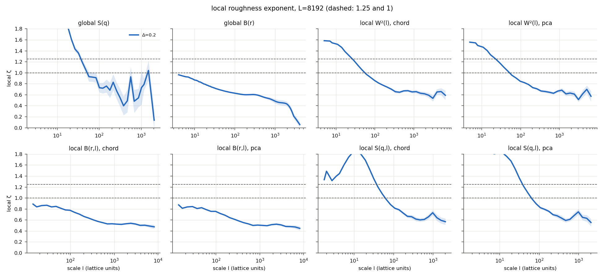
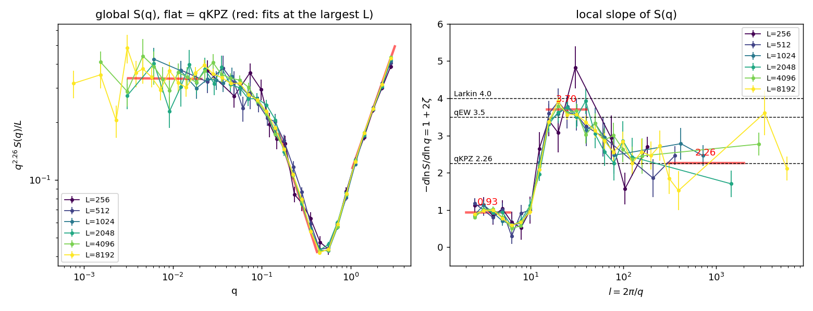
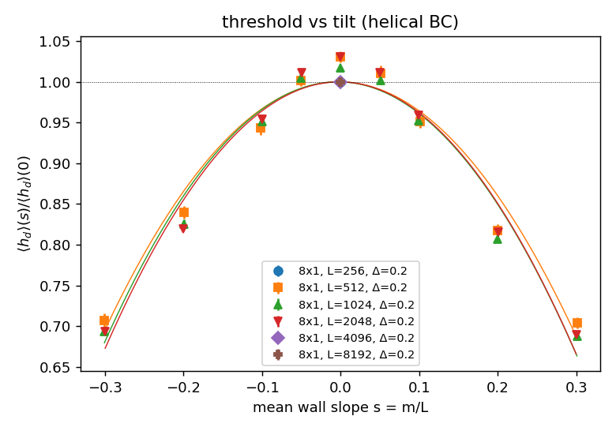

# Mathematics of the solver and of the analysis

This document writes out, in the code's notation, everything that is
computed: the model and the algorithm that finds the depinning field and
the critical configuration (`main.cu`, `misistema.h`), the extraction of
the wall (`scripts/wall_contour.py`), the roughness estimators
(`scripts/roughness_estimators.py`, `scripts/local_roughness.py`), and
the two-crossover model (`scripts/fit_crossovers.py`). The results of
the `L = 1024, 2048` sweep are at the end (figures in
`results/sweep_L1024_L2048/`); those of the $\kappa=20$ production at
$L=8192$, $\Delta=0.3$ in §5.6 (figures in `results/kappa20_L8192_D0.3/`).

Reference: A. B. Kolton, E. E. Ferrero, A. Rosso, Phys. Rev. B **108**,
174201 (2023).

---

## 1. Model

Scalar field $\phi(x,y)$ on an $L_x\times L_y$ lattice ($L \equiv L_x$):

```math
\partial_t \phi = c\,\nabla^2\phi + \epsilon_0\left[(1+r(x,y))\,\phi - \phi^3\right] + h
```

- $\nabla^2$ is the 5-point discrete Laplacian.
- The disorder is *random bond*: $r(x,y)$ is independent from site to
  site and uniform in $[-\Delta,\Delta]$, so $\langle r\rangle = 0$ and
  $\langle r^2\rangle = \Delta^2/3$ (`site_disorder`, a Random123
  generator keyed by site and seed).
- $c$ = `CEL`, $\epsilon_0$ = `EPSILON0` and $\Delta$ = `AMPDIS`; the
  runs use $c = \epsilon_0 = 1$.

**Boundaries.** Periodic in $x$, $\phi(x+L_x,y) = \phi(x,y)$;
anti-periodic in $y$, $\phi(x,y+L_y) = -\phi(x,y)$. With an anti-periodic
boundary any configuration has an odd number of walls, so there is
always a wall spanning the sample, and no fixed boundary that holds or
pulls it. For $h>0$ the $\phi>0$ region lies below the wall and grows
as $h$ increases. (Up to commit `9548076` the sign flip was applied to
the wrong neighbour, the interior one, of the rows $y=0$ and $L_y-1$.
That left a fixed defect at the seam, rows at $\phi\approx\mp0.24$, far
from the wall: in a square box the $h_d$ of 20 seeds came out identical
with either boundary.)

**Box height.** The wall starts at $0.2L_y$ and escapes at $0.95L_y$, so
$h_d$ is the strongest pinning met over a path $0.75L_y$ long, and it
grows with $L_y$. The wall's vertical extent grows as $L_x^{\zeta}$, so
for finite-size scaling the box keeps its shape in those units,
$`L_y = k\,L_x^{\zeta}`$ with $\zeta = 1.25$ and fixed $k$ (`--ly-k`,
rounded to a multiple of 32). A square box has $k = L^{-1/4}$, which
shrinks with $L$. At $L=1024$ the extent of the critical wall is
0.02–0.08 $L_x^{1.25}$ on average (Δ = 0.4–1.0), up to 0.12; going from
the square box to $k=1$ raises $h_d$ by 2.9 % (Δ = 0.4) and 1 % (Δ = 1).
With $k = 1$ the wall spans at most ~12 % of $L_y$.

**Path, headroom and censoring.** Two things in that geometry bias the
sample of critical walls:

- **The aspect ratio sets a finite-size regime** (Kolton, Bustingorry,
  Ferrero, Rosso, arXiv:1308.4329). A short path biases $\langle h_d\rangle$
  low. A long one makes $h_d$ an extreme over many independent stretches,
  and selects rare, wide critical walls. In between there is a $\kappa^*$
  where finite-size effects are smallest. Because of the Larkin and
  multivalued regimes, the right measure is the path over the wall's
  width, $\kappa = P/w(L_x,\Delta)$, not $L_y/L_x^{1.25}$.
- **The legacy escape test censors wide walls.** That test fires as soon
  as *some* site crosses $y_e$. If a sample's strongest pinning lies just
  below $y_e$, a protrusion reaches it, the trial counts as depinned, and
  the sample ends up with a weaker pinning further down. This is more
  likely the wider the wall, so the widest critical walls are the ones
  lost.

With `--path P --headroom H` the wall starts at $y_0$ (32 rows above the
seam) and has escaped once *all* of row $y_e = y_0+P$ has flipped. Since
the motion is monotone, it can't come back after that. $L_y = y_0+P+H$,
so a pinned wall may stick out up to $H$ above $y_e$. Above $l_o$ a
bubble of the old phase can pinch off and stay pinned on row $y_e$, so
that row never flips while the wall runs on; the wall has therefore also
escaped once all of row $y_e + H/2$ has flipped (a pinned wall can't be
wholly above it without having crossed $y_e$). On $L=1024$, Δ = 1, one
seed in 30 needed it. If $H$ is too
small, the tip reaches $L_y$ and is held by the seam. The trial then
counts as pinned and $h_d$ comes out high: on one seed of $L=512$,
Δ = 1, $P = 912$, it was 0.06718 with $H = 64$–256 against 0.06664 with
$H = 512$.

The solver reports the critical wall's rows and warns when it comes
within 32 rows of $L_y$. `run_batch.py --adapt-headroom` then solves that
seed again with twice the headroom. The disorder of a site is keyed by
$x + L_x y$, which doesn't depend on $L_y$, so it is the same sample and
the same path: nothing is discarded, which would bias against wide walls.
On $L=512$, Δ = 1 with 30 seeds and a starting $H = 64$, 5 seeds needed
$H$ = 256–512. All 30 $h_d$ then agreed with a run at $H = 2000$, with
extents up to 387 rows ≈ 0.4 P.

**Tilt and anisotropic disorder.** For qKPZ depinning the threshold
must depend on the wall's mean slope $s$, with
$`\lambda_c = F_c''(0) \neq 0`$ (Tang, Kardar, Dhar, PRL **74**, 920
(1995)). In an isotropic medium $F_c(s)$ is flat (the projection term is
$\propto v$ and vanishes at threshold), hence qEW. Two options probe and
break this:

- **`--tilt m`**: helical boundary in $x$,
  $`\phi(x+L_x,y) = \phi(x,y-m)`$, so the wall has mean slope
  $s = m/L_x$. Across the boundary the shifted row can wrap around the
  anti-periodic seam (sign flip). $m$ must be even so that $x$-neighbours
  keep opposite checkerboard colours, and the active-tile bookkeeping
  takes the shifted rows into account. The wall starts straight, with
  its lowest row at $y_0$, and $L_y = y_0+P+\lvert m\rvert+H$. Checks
  (L = 512, Δ = 0.3): with $m=0$ the critical fields are bit-for-bit
  those of the previous code (3 seeds); with $m=\pm64$ active tiles and
  whole-lattice sweeps give bit-identical fields; the saved wall is
  continuous across the boundary, $u(L_x-1)\approx u(0)+m$.
- **Block disorder** (`AX`, `AY` at compile time): $r(x,y)$ is constant
  over blocks of $AX\times AY$ sites, keyed by the block, so it is
  correlated and, for $AX\neq AY$, anisotropic. Anisotropic elasticity
  alone ($c_x\neq c_y$) would not do: a rescaling of $x$ and $y$ makes it
  isotropic, and uncorrelated disorder stays uncorrelated. Blocks of
  $4\times1$ about double $h_d$ at Δ = 0.3 (0.0269 against 0.0136 on one
  seed), so Δ must be lowered to compare at equal $h_d$.

**Equilibrium states.** Without disorder or field the local minima are
$\phi = \pm 1$. The flat wall is $\phi_0(y-u) = \tanh[(y-u)/\xi\sqrt2]$
(with the sign set by the boundary), of width $\xi = \sqrt{c/\epsilon_0}$
in the continuum.

## 2. Variant Monte Carlo (VMC)

### 2.1 Elementary move

At each site, the steady-state condition $\partial_t\phi_i = 0$ with the
neighbours held fixed is a cubic in $\phi_i$:

```math
c\left(\textstyle\sum_{\rm nn}\phi - 4\phi_i\right) + \epsilon_0\left[(1+r_i)\phi_i - \phi_i^3\right] + h = 0
\;\Longleftrightarrow\;
\phi_i^3 + p\,\phi_i - q = 0,
```

```math
p = \frac{4c}{\epsilon_0} - (1+r_i), \qquad q = \frac{c\sum_{\rm nn}\phi + h}{\epsilon_0}.
```

`vieta_solver` solves the cubic. With $Q = p/3$, $R = q/2$ and
$D = Q^3 + R^2$:

- **If $D \ge 0$** there is a single real root (Cardano):
  $\phi = \sqrt[3]{R+\sqrt D} + \sqrt[3]{R-\sqrt D}$.
- **If $D < 0$** there are three real roots (Vieta's trigonometric
  form):

```math
\phi_k = 2\sqrt{-Q}\,\cos\frac{\theta + 2\pi k}{3},\quad k=0,1,2,\qquad \theta = \arccos\frac{R}{\sqrt{-Q^3}},
```

with $\phi_0 > \phi_2 > \phi_1$: the largest, the middle and the
smallest.

The middle root $\phi_2$ is unstable. The move sends $\phi_i$ to the
stable root in the same basin as its current value: to $\phi_0$ if
$\phi_i > \phi_2$, and to $\phi_1$ otherwise. The site thus jumps
straight to the nearest local minimum instead of integrating the
dynamics.

### 2.2 Sweeps and convergence

- **Checkerboard.** All sites with $x+y$ even are updated in parallel,
  then the odd ones (two colours per sweep). Since a site's four
  neighbours are all of the other colour, each half-update is exact.
- **Active tiles.** The move is idempotent: with the same neighbours it
  returns the same value. A site therefore only needs updating if a
  neighbour changed in the previous (other-colour) half-sweep. The
  lattice is split into $32\times32$ tiles, and a half-sweep only
  updates the tiles where, in the previous half-sweep, some site of the
  tile or of its 4 neighbouring tiles changed (`vmc_tiles_kernel`,
  `spread_activity`). Skipping the rest is exact: with this rule alone
  the result is bit-for-bit that of updating every site (checked). In
  float arithmetic, though, converged sites keep flickering in the last
  bit, so no tile would ever go quiet. A change $|\delta\phi| \le$
  `TILE_EPS` $=10^{-6}$ is therefore applied but does not keep the tile
  active. It leaves residuals $`\sim c\,`$`TILE_EPS` on the neighbours,
  well below the stopping cutoff, and each block of `chop` sweeps
  starts with one full sweep. Near $h_d$ the wall moves by local
  avalanches, and the work drops to a few % of the full sweeps.
- **Residual velocity.** The legacy criterion (`--tolres 0`) computes,
  every `chop` = 100 sweeps,

```math
v = \frac{1}{L}\sum_{i=1}^{L^2}\partial_t\phi_i
```

  (`velocity_phi`). It is normalised by $L$, not $L^2$: since $\phi$
  jumps by 2 across the wall, a wall of length $L$ moving at mean
  velocity $\bar v_{\rm wall}$ gives
  $`\sum_i\partial_t\phi_i\approx 2L\,\bar v_{\rm wall}`$, so
  $v\approx 2\bar v_{\rm wall}$ whatever the size.
  and stops when $|v| <$ `TOLVEL` $= 10^{-4}$.
- **Why that is not enough.** $v$ is a mean over the wall. A local
  avalanche of size $l$ moving at speed $v_a$ only contributes
  $`\sim l\,v_a/L`$, so at large $L$ the relaxation can stop on a wall
  that is still moving. Relaxing the saved legacy critical
  configurations further, at the same $h$, showed that 13–43 % of them
  (by set, $L=1024$–$2048$, $\Delta=0.4$, $1.0$) were not metastable:
  the wall moved on by up to hundreds of rows, and 3 of 120 depinned.
- **Stopping (default).** A local criterion: the largest residual

```math
\max_i |\partial_t\phi_i| < \texttt{TOLRES} = 10^{-5}
```

  (`max_residual`), which vanishes only at a fixed point. Just above
  $h_d$, however, the dynamics has the bottleneck of a saddle-node
  bifurcation: the wall lingers almost still for many sweeps before
  escaping, and an instantaneous residual can't tell that from a fixed
  point. The criterion is therefore confirmed: once it holds, no site may
  move more than `CONFIRM_DPHI` $=10^{-4}$ over the next
  `CONFIRM_SWEEPS` $=1000$ sweeps (a mean speed 100 times below
  `TOLRES`); otherwise the wait starts again. Checks are made every
  `chop` = 1000 sweeps.
- **Cap.** After $`\max(2\times10^6,\,2000L)`$ sweeps (`MAXSWEEPS`,
  `MAXSWEEPS_PER_L`) the relaxation gives up, and a trial still moving
  then counts as *depinned*. Near $h_d$ relaxations get very long at
  large $L$: at $L=8192$ a pinned trial took $8.3\times10^5$ sweeps to
  converge, and a trial that hit the former cap ($5\times10^5$ sweeps,
  then counted as pinned) escaped $2.3\times10^5$ sweeps later, which
  had both raised $h_d$ and saved a moving wall as the critical
  configuration. Counting a capped trial as depinned keeps every
  critical configuration a confirmed fixed point, at the cost of an
  $h_d$ that can only come out low, and only if a pinned relaxation
  outlasts the cap. The solver prints "still moving at the cap" when
  that happens.
- **The cap must exceed the slowest pinned relaxation, which grows with
  the path.** With the $\kappa=20$ path ($P=10911$ rows at $L=8192$),
  pinned trials converged after up to $5.2\times10^6$ sweeps, past the
  former $500L=4.1\times10^6$. With that cap, 8 of 18 production samples
  ($L=8192$, $\Delta=0.3$) ended with a capped trial as the upper
  bracket; re-solved with $2000L$, 6 of them rose by 0.05–0.85 % and 2
  were unchanged (sample 18 had pinned, in an earlier run, above the
  field where its capped trial was counted as depinned). The mean of the
  18 was 0.16 % low, 1.5 times its statistical error (0.11 %). Check
  "still moving at the cap" in the logs: no capped trial should set the
  final upper bracket.

### 2.3 Depinning field by bisection

For each trial $h$ (`find_depinning_field`):

1. **Initial condition:** the last pinned state found (warm start,
   below). The first trial starts from the flat wall, $\phi = +1$ for
   $y < 0.2L_y$ and $\phi=-1$ for $y \ge 0.2L_y$.
2. **Relaxation** with the rule above, with an early exit once the wall
   has escaped (`System::escaped`). By default that means it reaches the
   row $y_e = 0.95L_y$ somewhere, $\max_x \phi(x, y_e) > 0$. With
   `--path`, it means it has crossed $y_e = y_0+P$ everywhere,
   $\min_x \phi(x, y_e) > 0$, or row $y_e+H/2$ everywhere (past a
   pinned bubble; see §1).
3. **Classification:** the trial is *depinned* if it escaped, and
   *pinned* otherwise.

First the ends are checked: $h_{\rm low}$ must be pinned (if not, it is
divided by 1.5) and $h_{\rm high}$ depinned (if not, it becomes the new
$h_{\rm low}$ and $h_{\rm high}$ is multiplied by 1.5), so a bracket
that misses a sample's $h_d$ costs a few trials, not a wrong result.
Bisection on $[a,b]$ then replaces $a$ (pinned) or $b$ (depinned) by the
midpoint until $b-a \le$ `tol` $= 10^{-4}$. This defines

```math
h_d \equiv a, \qquad \text{critical configuration} = \text{metastable state at } h_d.
```

(The legacy code then stepped back, $a \leftarrow a-\text{tol}$, until
the trial was pinned again, and reported that. Its $h_d$ are thus one
`tol` lower.)

**Warm starts.** Let $M(h)$ be the state reached from the flat wall at
field $h$. For $a < h$, the pinned state $M(a)$ lies between the flat
wall and $M(h)$, so by no-passing (below) the dynamics started from
$M(a)$ also ends at $M(h)$, or escapes if and only if the flat start
escapes. Each trial therefore starts from the last pinned state, and
after an escape that state is restored (`save_state`,
`restore_state`). The wall only has to move from $M(a)$ to $M(h)$
instead of all the way from $y=0.2L_y$, and the final step-back is no
longer needed: the saved state at $a$ *is* the critical configuration.
The ordering argument is not strict in the bulk, where the flat
start's $\pm1$ differs from the relaxed $\pm\sqrt{1+r}$ either way;
those sites relax in a few sweeps, so it only matters near the wall.
The check is therefore empirical: `--verify-cold` relaxes once more
from the flat wall at $h_d$ and compares. With the default stopping criterion the two agree in every
sample tested (60, $L=512$–$2048$): both pinned, $\max|\delta\phi|
\le 5\times10^{-4}$. With the legacy criterion they did not: the warm
start then stops on slow local avalanches even more easily, and
reported $h_d$ up to 5 `tol` too high.

**Why restarting from the flat wall is valid.** By Middleton's
no-passing theorems the dynamics preserves order: if $\phi \le \phi'$
at every site, it stays so. Hence, at fixed $h$, whether the wall gets
pinned or escapes does not depend on the path. Concretely, the VMC rule
is monotonic: the roots of the cubic increase with $q$, i.e. with the
neighbours and with $h$, and the threshold $\phi_2$ decreases.

**Why the early exit doesn't change $h_d$.** With the anti-periodic
boundary, the magnetisation $M = \sum\phi$ grows as the wall moves up
and is largest with the wall at $y = L_y$. A depinned wall advances to
there and converges, instead of circulating. Stopping once it crosses
$y_e$ doesn't change the classification, since the decision is made on
that row anyway. Pinned trials never cross $y_e$, so they relax exactly
as before and the saved critical configuration is unchanged. Checked on
13 seeds: same $h_d$, and at $L=1024$ the total time dropped by 32 %.

**Initial bracket.** `slurm_sweep.sh` uses $`[0.85,\,1.15]\,h_{\rm est}`$
with $`h_{\rm est} = 0.0195\,(\Delta/0.4)^{1.34}`$, the fit of the
$L=1024$–$2048$ sweep (§8); `sweep_disorder.sh` keeps $`[0,\,3h_{\rm est}]`$
with $`h_{\rm est} = 0.008\,(\Delta/0.2)^{4/3}`$ (Larkin scaling, §7).

**Cost.** Per sample, on the same GPU, legacy vs. default: $L=2048$,
$\Delta=0.4$: 254 s → 33 s (×8); $\Delta=1.0$: 250 s → 13 s (×19);
$L=4096$, $\Delta=1.0$: 1361 s → 62 s (×22). The gain grows with $L$:
the warm start saves the wall's travel, $\propto L$, and the tiles
skip the quiet part of the lattice, a growing fraction.

## 3. The wall as a curve

The critical configuration is saved in full (`--dump-field`). The points
in `critica_*.dat` can't be used for this analysis: they only detect
sign changes along $y$, so they miss the vertical stretches (the
overhangs) and come unordered.

1. **Contour.** The wall is the $\phi = 0$ level line, traced with
   sub-pixel *marching squares* (`skimage.measure.find_contours`) on the
   field tiled 3 times along $x$. The code takes the longest open
   contour that spans the three copies without touching the boundary
   rows in $y$, and cuts exactly one period, from a point $P$ to
   $P + (L,0)$. Closed contours are bubbles (isolated domains): they are
   counted and discarded.
2. **Arc-length resampling.** The curve is resampled with $n$ points
   equally spaced in arc length $s$, with
   $ds = s_{\rm tot}/n \approx 1$ (`periodic_arclength`), so that point
   $n$ is the image of point 0. The total arc length per period,
   $s_{\rm tot}/L \ge 1$, measures how far the wall is from a straight
   line.
3. **Univalued profile** (Eq. 9 of the paper, `univalued_profile`). At
   each column $x+\tfrac12$ the curve crosses $m(x)$ times (an odd
   number) at heights $u_n(x)$, and

```math
u(x) = \frac{1}{m(x)}\sum_{n=1}^{m(x)} u_n(x).
```

   A column has an overhang if $m(x)\ge 3$. From this,
   $`\rho_{\rm cols} = \langle\, \mathbb 1[m(x)\ge3]\,\rangle_x`$ is the
   fraction of multivalued columns, and a sample counts as "having
   overhangs" if it has at least one.

## 4. Roughness observables

### 4.1 Global, on $u(x)$

With $\delta u = u - \bar u$ and $q_k = 2\pi k/L$ ($k = 1..L/2$):

```math
S(q_k) = \frac{1}{L}\left|\sum_x \delta u(x)\,e^{-iq_kx}\right|^2,\qquad
B(r) = \langle[u(x+r)-u(x)]^2\rangle_x = 2[C(0)-C(r)],\qquad
W^2 = \langle\delta u^2\rangle_x,
```

where $C(r)$ is the circular autocorrelation, computed by FFT. For a
self-affine interface with exponent $\zeta$:

```math
S(q)\sim q^{-(1+2\zeta)},\qquad B(r)\sim r^{2\zeta},\qquad W^2\sim L^{2\zeta}.
```

**Limitation for $\zeta>1$** (super-roughness, like qEW with
$\zeta\approx1.25$). Since $|u(x+r)-u(x)| \le r\max|u'|$, $B(r)$ can't
grow faster than $r^2$: for $\zeta > 1$ the increments are dominated by
the local slope and $B \sim r^{2\min(\zeta,1)}$. The same holds for the
whole-sample $W^2$. So the global $B$ and $W^2$ report $\zeta = 1$, and
among the global observables only $S(q)$ sees $\zeta>1$.

### 4.2 Local, on rotated segments

The code takes every segment of arc length $l$ (with $l+1$ points,
starting every $l/2$ points along the period, `_segments`). Each segment
is rigidly rotated so that its tilt $\theta$ becomes horizontal. With
$(dx, dy)$ measured from the first point:

- **Chord** (`chord`): $\theta = \mathrm{atan2}(dy_{\rm end}, dx_{\rm end})$,
  the straight line between the ends.
- **Principal axis** (`pca`): $`\theta = \tfrac12\mathrm{atan2}(2s_{xy},\, s_{xx}-s_{yy})`$,
  with $s$ the covariances of the segment's points. It is the axis of
  least perpendicular spread.

```math
X_r(s) = \cos\theta\,dx + \sin\theta\,dy,\qquad h(s) = -\sin\theta\,dx + \cos\theta\,dy.
```

$h(s)$, the coordinate perpendicular to the axis as a function of arc
length $s$, is well defined even when the wall has overhangs. Averaging
over segments:

```math
W^2(l) = \left\langle \mathrm{var}_s h \right\rangle,\qquad
B(r,l) = \left\langle[h(s+r)-h(s)]^2\right\rangle_{s},\qquad
\theta^2(l) = \langle\theta^2\rangle .
```

In the self-affine regime $W^2(l)\sim l^{2\zeta}$ even for $\zeta>1$:
subtracting each segment's tilt removes the $\sim l^2$ component that
saturates $B$. Synthetic profiles with pure $\zeta = 1.25$ confirm it:
$\zeta_W$ reads between 1.20 and 1.27 for $7 \le l \lesssim L/6$, with
no upward bias at small scales. $B(r,l)$, instead, is still capped at
$\zeta\le1$, because the increments within a segment are also dominated
by the local slope; on the data it reads ≈ 0.8.

**Local structure factor.** With $\delta h = h - \bar h$:

```math
\text{chord (FFT):}\quad S(q,l) = \frac{ds}{l}\left|\sum_s \delta h(s)e^{-iqs}\right|^2,\quad q = \frac{2\pi k}{l};
```

```math
\text{principal axis (DCT-II):}\quad S(q,l) = \frac{ds}{2l}\,\big[\mathrm{DCT}(\delta h)_k\big]^2,\quad q = \frac{\pi k}{l}.
```

The DCT is the FFT of the even extension of $h$, of period $2l$. **Why
each transform:** the FFT assumes the segment is periodic.

- If $h(0)\ne h(l)$, as happens with the principal axis, the jump at the
  boundary gives coefficients $\sim 1/q$ and $S\sim q^{-2}$, i.e. an
  apparent $\zeta = 0.5$.
- With the chord, $h(0)=h(l)=0$ by construction, so there is no jump.
- The even extension has no jump either, only a kink in the slope,
  which gives $\sim 1/q^2$ and $S\sim q^{-4}$, enough to measure
  $\zeta < 1.5$.

### 4.3 Multivalued fraction

A segment is still multivalued in its own frame if its along-axis
coordinate backtracks by more than one lattice spacing:

```math
f_{\rm mv}(l) = \Big\langle \mathbb 1\Big[\max_s\big(\max_{s'\le s}X_r(s') - X_r(s)\big) > 1\Big]\Big\rangle_{\rm segments}.
```

It is $0$ for a self-affine wall (at scale $l$ it is a graph in its own
frame) and tends to $1$ once overhangs dominate that scale.

## 5. Local exponents and crossover length

### 5.1 Scale-dependent exponent

For a curve $y(x)$ on log-log scales, the local slope is that of the
least-squares line of $\log y$ against $\log x$, through the points
within $\pm0.15$ decades of each $x$ (`local_slope`):

```math
\zeta_W(l) = \tfrac12\,\frac{d\ln W^2}{d\ln l},\qquad
\zeta_S^{\rm glob}(\ell = 2\pi/q) = -\tfrac12\left(\frac{d\ln S}{d\ln q}+1\right).
```

The global $S$ is first averaged in logarithmic bins (12 per decade).
From the local spectrum, $S(q,l)\sim q^{-(1+2\zeta)}$ is fitted over
$k=2..8$ (FFT) or $k=4..16$ (DCT), i.e. over wavelengths $l/8..l/2$ in
both cases, and $B(r,l)\sim r^{2\zeta}$ over $`r\in[l/16,\, l/4]`$.

### 5.2 Definitions of $l_o$

$l_o(L,\Delta)$ is the first scale, interpolated in $\ln l$, where:

| definition | criterion |
|---|---|
| `zW_chord`, `zW_pca` | $\zeta_W(l)$ drops below $\zeta_{\rm th} = 1.125$ (for $l\ge 8$) |
| `zS_glob` | $\zeta_S^{\rm glob}$ drops below $\zeta_{\rm th}$ |
| `fmv_chord`, `fmv_pca` | $f_{\rm mv}(l)$ rises above $0.05$ |

The threshold on $f_{\rm mv}$ is low because $f_{\rm mv}$ only
approaches 1 for $L \gg l_o$.

### 5.3 Data collapse

At fixed $L$, if $g(l) = G(l/l_o(\Delta))$ for a common function $G$,
shifting the curves in $\ln l$ by $a_\Delta = \ln[l_o(\Delta)/l_o(\Delta_0)]$
makes them all fall on top of each other. `collapse_shifts` minimises

```math
\mathcal C(\lbrace a\rbrace) = \frac{1}{N_{\rm pairs}}\sum_{i\lt j}\big\langle [g_i(\ln l + a_i) - g_j(\ln l + a_j)]^2\big\rangle_{\rm overlap},
```

with $a_{\Delta_0} = 0$ (Nelder–Mead). A pair of curves overlapping by
less than 0.3 in $\ln l$ is penalised. For $f_{\rm mv}$ only the part
of each curve with $f_{\rm mv}\ge0.01$ is used, since a curve that is
identically zero collapses onto anything.

### 5.4 Exponent $\alpha$ and the finite-size cut

```math
l_o \sim \Delta^{-\alpha}:\qquad \ln l_o = c - \alpha\ln\Delta \quad\text{(least squares)}.
```

The paper gives $\alpha \approx 1/0.45 \approx 2.2$.

**Finite size.** Even without a crossover, $\zeta_W(l)$ drops near
$l\sim L/2$, because a segment comparable to the sample is constrained
by periodicity. Comparing the two sizes, $l_o$ agrees up to
$\approx L/4$ ($\Delta=0.7$: 240 vs 237) and is overestimated beyond
($\Delta=0.6$: 365 vs 274, at $0.36L$). Hence (`--lo-max-frac 0.25`):

- the $\alpha$ fits leave out the $\Delta$ values with $l_o > L/4$,
  decided on the full sample;
- the collapses leave out the same $\Delta$ values (by the $f_{\rm mv}$
  $l_o$) and only use scales $l\le L/4$.

### 5.5 Errors

Bootstrap over samples: the $n$ samples are resampled with replacement
and every average, curve, $l_o$, collapse and fit is recomputed. The
error of a quantity is the standard deviation over resamples. This
method is used because neighbouring points in $l$ are correlated, as
they come from the same overlapping segments, so a fit's $\chi^2$
doesn't give reliable errors.

### 5.6 Bias of the local estimators

`scripts/synthetic_profiles.py` feeds Gaussian single-valued profiles
with a known $S(q)$ through the same measurement code. At $L=8192$, 30
profiles, medians of the local exponent over a scale window:

| input | window | $\zeta_W$ chord | $\zeta_W$ pca | $\zeta_S$ chord | $\zeta_S$ pca |
|---|---|---|---|---|---|
| pure 1.25 | $8\le l\le L/2$ | 1.237 | 1.227 | 1.295 | 1.328 |
| 1.25 → 1.0 at $l_o=1500$ | $8\le l\le l_o/2$ | 1.232 | 1.220 | 1.291 | 1.315 |
| 1.45 → 1.25 at $l_c=100$ → 1.0 at $l_o=1500$ | $2l_c\le l\le l_o/2$ | 1.229 | 1.221 | 1.266 | 1.292 |
| same | $l\ge 2l_o$ | 0.985 | 0.953 | – | – |

(Bootstrap errors 0.003–0.02; 0.04 above $l_o$. $\zeta_S$ is plotted
and windowed at the probed wavelength $l/4$.)

- **$W^2(l)$ reads low, $S(q,l)$ high**, by about the same amount with
  or without crossovers nearby: $-0.02$ (chord) and $-0.03$ (pca) for
  $\zeta_W$; $+0.02$ to $+0.05$ (chord) and $+0.04$ to $+0.08$ (pca) for
  $\zeta_S$. A gap of $\approx0.05$ between $\zeta_W$ and $\zeta_S$ on
  the same walls is therefore expected, not a sign of trouble.
- **The estimators bracket the true exponent**, so the bias-corrected
  values, or the range between $\zeta_W$ chord and $\zeta_S$ chord, are
  what to quote.
- **Caveat:** the walls are neither Gaussian nor single-valued (79 % of
  the $L=8192$, $\Delta=0.3$ critical walls have overhangs), so their
  bias may differ somewhat.

Applied to the critical walls at $L=8192$, $\Delta=0.3$ ($\kappa=20$
box, window $200\le l\le750$, $\zeta_S$ at $l/4$ in the window),
corrected with the third row:

| walls | $\zeta_W$ chord | $\zeta_W$ pca | $\zeta_S$ chord | $\zeta_S$ pca |
|---|---|---|---|---|
| 30 samples, `--tol 1e-5`, cap $2000L$ (final), raw | 1.211 | 1.206 | 1.274 | 1.296 |
| same, corrected | **1.232** | **1.235** | **1.258** | **1.254** |
| 14 samples, `--tol 1e-4` (preliminary), raw | 1.192 | 1.184 | 1.244 | 1.282 |
| same, corrected | 1.213 | 1.213 | 1.228 | 1.240 |

The four corrected estimators of the final set agree within 0.03, at
$\zeta_q\approx1.245\pm0.015$ (their mean and half-spread), consistent with the qEW value 1.25. The preliminary
walls, saved up to 0.5 % below $h_d$, read lower. For this set,
$\langle h_d\rangle = 0.013392\pm0.000008$, and $l_o$ = 1504 ± 140
(chord) and 1167 ± 190 (pca) from the multivalued fraction, against
$`102\,\Delta^{-2.1}\approx1280`$.





The plateau of $S(q,l)$ (chord) and $W^2(l)$ near 1.2–1.25 spans
$100\lesssim l\lesssim2000$; above, the multivalued fraction rises and the
local exponent of $W^2$ drops towards 1. The global $S(q)$ and $B(r)$ of
$u(x)$ are useless here: 93 % of the walls have overhangs.

### 5.7 Sample-to-sample spread of $h_d$

`scripts/hd_variance.py` (figure in `results/hd_variance/`). At fixed
$\kappa$, the spread of the threshold should scale as
$`\sigma(h_d)\propto L^{-1/\nu}`$ with $1/\nu = 2-\zeta_q = 0.75$. The
bisection grid (step $`\approx 6`$–$`8\times10^{-5}`$ with `--tol 1e-4`)
is removed with Sheppard's correction $-\mathrm{step}^2/12$ on
$\sigma^2$ (at most 6 %, at $L=2048$, $\Delta=0.2$).

| $\Delta$ | $\kappa$ | $1/\nu$ ($L=256$–2048) |
|---|---|---|
| 0.2 | 15 / 25 / 40 | 0.91 ± 0.08 / 0.76 ± 0.09 / 0.82 ± 0.10 |
| 0.3 | 15 / 25 | 0.77 ± 0.07 / 0.89 ± 0.07 |
| 1.0 | 15 / 25 | 1.10 ± 0.07 / 0.85 ± 0.08 |

Most fits lie between 0.75 and 0.9, slightly above $2-\zeta_q$. The
$L=8192$, $\kappa=20$ point ($`\sigma/\langle h_d\rangle = 0.31\,\%`$)
falls on the $L^{-0.75}$ continuation of the $\Delta=0.3$ curves (right
panel of the figure): between $L=2048$ ($\kappa=15$ or 25) and 8192 the
slope is 0.67–0.78, with an error of about ±0.1.

**qEW vs qKPZ.** In 1+1, qKPZ depinning maps onto directed percolation:
$`\zeta = \nu_\perp/\nu_\parallel = 1.097/1.734 \approx 0.63`$ and
$`\nu = \nu_\parallel \approx 1.73`$, so $1/\nu\approx0.58$. Without the
statistical tilt symmetry, $\nu = 1/(2-\zeta)$ does not hold for qKPZ; it
would give 0.73, nearly the qEW value. Fixing the slope and fitting one
amplitude per $(\Delta,\kappa)$:

| slope | $\chi^2$ (21 dof) |
|---|---|
| 0.75 (qEW) | 44 (26 of it from $\Delta=1$, $\kappa=15$) |
| 0.577 (qKPZ) | 130 (worse for every set) |

A common free slope gives $1/\nu = 0.88\pm0.03$ ($\chi^2 = 24/20$),
above both: corrections to scaling from $L=256$ up. The spread therefore
favours qEW without pinning $1/\nu$ to 0.75. The roughness is the
decisive test: $\zeta = 1.23$–1.26 on the plateau (§5.6) against 0.63
for qKPZ, and the effective exponent above $l_o$ tends to 1, not 0.63.
A qKPZ term needs a slope-dependent velocity, i.e. an anisotropic
medium, which the $\phi^4$ wall with isotropic disorder does not have.



### 5.8 Threshold versus tilt: isotropic and anisotropic disorder

`scripts/hd_tilt.py`, on runs with the helical boundary `--tilt m` (§1),
which imposes a mean wall slope $s = m/L$. For each $s$, 30 seeds and
`--tol 1e-5`. The quantity plotted is $`\langle h_d\rangle(s)/\langle h_d\rangle(0)`$,
where $`\langle h_d\rangle(0)`$ is the fitted value at $s=0$, with error
bars equal to the standard error of the mean. The lines are weighted fits
$`\langle h_d\rangle(s) = a + b\,s + \tfrac12 h_d''\,s^2`$.

**Why this test.** The field $h$ is a pressure: it pushes the wall along
its normal with the same strength at any orientation. In an isotropic
medium the pinning is also the same at any orientation, so the threshold
does not depend on $s$; the only $s$-dependence of the velocity is the
projection $v_y = v_n\sqrt{1+s^2}$, which vanishes at threshold. That is
qEW. In the KPZ equation
$`\partial_t u = c\,\nabla^2 u + \tfrac{\lambda}{2}(\nabla u)^2 + F`$,
a tilt $s$ adds $`\tfrac{\lambda}{2}s^2`$ to the drive, so the threshold
becomes $`F_c(s) = F_c(0) - \tfrac{\lambda}{2}s^2`$: a curvature of
$h_d(s)$ at threshold is a nonzero $`\lambda = -h_d''(0)`$, the coupling
that makes depinning qKPZ (Tang, Kardar, Dhar, PRL **74**, 920 (1995)).
It only appears if the medium is anisotropic.

**The tilt in the KPZ equation.** Write $u = s\,x + \delta u$, with
$\delta u$ periodic (that is what the helical boundary imposes). Then

```math
(\nabla u)^2 = s^2 + 2s\,\nabla\delta u + (\nabla\delta u)^2 ,
```

```math
\partial_t\delta u = c\,\nabla^2\delta u + \lambda s\,\nabla\delta u
 + \tfrac{\lambda}{2}(\nabla\delta u)^2 + \Big(F + \tfrac{\lambda}{2}s^2\Big) + \eta(x,u).
```

- **The linear term** $\lambda s\,\nabla\delta u$ is a drift along $x$
  at speed $\lambda s$. In the thermal KPZ equation it can be removed by
  going to the frame $x' = x + \lambda s\,t$. With quenched disorder it
  can't be removed, because the disorder is fixed in the lab frame: it
  makes the landscape seen by $\delta u$ asymmetric in $x$. Under
  $x\to-x$, $s\to-s$ and the disorder is statistically unchanged, so
  $F_c(s)$ is even in $s$ and this term too shifts $F_c$ starting at
  order $s^2$ (e.g. at second order in $\lambda s$). The measured
  curvature is therefore an effective coupling,
  $`\lambda_{\rm eff} = -h_d''(0)`$, which contains $\lambda$ plus this
  contribution. Its sign, not the bare $\lambda$, is what is compared
  with the classes below. The higher orders in $s$ are not controlled
  either, which is one possible reason the parabola fails beyond
  $\lvert s\rvert\approx0.1$ (§5.9).
- **The constant** $\tfrac{\lambda}{2}s^2$ adds to the drive. So
  $\delta u$ sees an effective force $F + \tfrac{\lambda}{2}s^2$, and it
  depins when that reaches $F_c(0)$:

```math
F_c(s) = F_c(0) - \tfrac{\lambda_{\rm eff}}{2}\,s^2 + O(s^4),\qquad
\lambda_{\rm eff} = -\,F_c''(0) = -\,h_d''(0).
```

**Velocity vs threshold.** At fixed $F$ above threshold, the same
argument gives $v(s) = v(0) + \tfrac{\lambda}{2}s^2$: for $\lambda>0$,
$v(s)$ is convex, with its minimum at $s=0$. Near depinning
$v = f\big(F - F_c(s)\big)$ with $f$ increasing, so a convex $v(s)$ is the
same statement as a concave $F_c(s)$. The two curvatures have opposite
signs, and both give the sign of $\lambda$. Physically, with $F$ pushing
towards $+u$ and $\lambda>0$, a tilted wall advances faster and depins
more easily.

**Why measure at threshold.** In the moving phase the effective
$\lambda$ from $v(s)$ depends on $F$: Amaral, Barabási and Stanley
(PRL **73**, 62 (1994)) find that it diverges at depinning in the models of
the directed-percolation class, and vanishes in the qEW ones. That is the
criterion they use to separate the two classes. The curvature of the
threshold, $-h_d''(0)$, is a property of the pinned state: it is finite,
and §5.9 finds it independent of $L$.

**Isotropic disorder** (`results/hd_tilt/hd_tilt.png`; $L=512$ and 1024,
$\Delta=0.3$ and 1.0, $\kappa=20$ boxes):



All points lie within 1 % of 1 up to $\lvert s\rvert = 0.3$ (a 17° tilt),
most within one or two standard errors, and the fitted curvature is zero
within its error:

| $L$ | $\Delta$ | $h_d''(0)/\langle h_d\rangle(0)$ | $\chi^2$ (4 dof) |
|---|---|---|---|
| 512 | 0.3 | −0.06 ± 0.12 | 1.6 |
| 512 | 1.0 | −0.03 ± 0.05 | 3.0 |
| 1024 | 0.3 | −0.04 ± 0.06 | 1.8 |
| 1024 | 1.0 | −0.01 ± 0.03 | 1.9 |

The lines drawn through the points are these fits: their apparent bends
are within the error bars, and they bend both ways. The linear term $b$,
which should vanish by the $x\to-x$ symmetry, is also compatible with zero
(−1.9σ to +1.3σ). So the square lattice adds no measurable anisotropy,
and $\lambda = 0$: a direct confirmation of qEW, independent of $\zeta$
(§5.6) and of the spread of $h_d$ (§5.7).

**Block disorder** (`results/hd_tilt_aniso/hd_tilt.png`; $L=512$,
$\Delta=0.3$, $r$ constant over blocks of $AX\times AY$ sites, same box as
the isotropic $\kappa=20$ one):



| blocks | $`\langle h_d\rangle(0)`$ | $s=-0.3$ / $+0.3$ | $h_d''(0)/\langle h_d\rangle(0)$ |
|---|---|---|---|
| 1×1 (isotropic) | 0.01341 | +0.4 / −0.3 % | −0.06 ± 0.12 |
| 2×2 (control) | 0.02421 | −1.0 / 0.0 % | −0.12 ± 0.12 |
| 2×1 | 0.01978 | −3.2 / −2.7 % | −0.60 ± 0.09 |
| 4×1 | 0.02631 | −11.1 / −10.5 % | −2.26 ± 0.11 |
| 8×1 | 0.02949 | −29.4 / −29.7 % | ≈ −6 (parabola fails, $\chi^2=42/4$) |
| 1×2 | 0.01632 | +0.5 / +0.4 % | +0.09 ± 0.14 |
| 1×4 | 0.01469 | +0.4 / +1.6 % | +0.13 ± 0.24 |
| 1×8 | 0.01006 | +1.5 / +2.7 % | +0.38 ± 0.29 |

What the figure shows:

- **Blocks elongated along the wall ($AX>AY$: red, brown, pink)** give
  curves that fall symmetrically on both sides of $s=0$, more steeply the
  longer the block: at $s=\pm0.3$, $h_d$ drops by 3 % (2×1), 11 % (4×1)
  and 30 % (8×1). A flat wall lies along the stripes of equal disorder and
  is pinned by whole stripes; a tilted wall cuts across them and averages
  the disorder over more blocks, so it depins more easily. Hence
  $h_d''<0$, i.e. $\lambda>0$ in the KPZ convention above, growing fast
  with $AX/AY$. For 8×1 the curve is not a parabola: it falls faster than
  the fit between $s=0.1$ and 0.2 and flattens towards 0.3, where it is
  already 30 % down; a fit restricted to small $\lvert s\rvert$ would be
  needed for its curvature.
- **Blocks elongated along the motion ($AY>AX$: blue, orange, green)**
  stay within 3 % of 1 and, if anything, rise with $\lvert s\rvert$
  ($\lambda<0$), but by at most 1.3σ: no conclusion yet.
- **The square 2×2 control (purple) is flat**, like the isotropic case.
  The effect therefore comes from the rectangular shape of the blocks,
  not from correlating the disorder or from the lattice.
- **The absolute thresholds change a lot with the blocks** (from 0.010 to
  0.030 at the same $\Delta$), and the boxes were not recalibrated, so
  $\kappa$ is not exactly 20 here. That doesn't affect the curvatures,
  which are ratios at fixed geometry, but $h_d(0)$ should not be compared
  across rows.

**Consequence.** Disorder correlated along the wall produces the qKPZ
coupling at depinning, with $\lambda>0$, the sign of the
directed-percolation depinning class ($\zeta\approx0.63$). The next test is
the roughness of the 4×1 and 8×1 walls at $s=0$ and larger $L$, with $P$
recalibrated from their width: qKPZ predicts the local exponent to cross
over from 1.25 to about 0.63 above a length set by $\lambda$. That test is
§5.9.

### 5.9 Weak block disorder: the qKPZ class

Plan in `docs/plans/aniso_weak_qkpz.md`; figures in `results/aniso_weak/`.
§5.8 found $\lambda>0$ for blocks elongated along the wall, but at
$\Delta=0.3$, $L=512$ and in boxes not recalibrated for them. Here the
disorder is weaker, so the elastic regime without overhangs is long, and
the scaling observables are measured up to $L=8192$.

**Choice of the case.** Pilot at $L=1024$ with 4×1 and 8×1 blocks and
$\Delta\in\{0.1,0.15,0.2\}$, 10 seeds, plus a short tilt at $L=512$
(`results/aniso_weak/pilot_*`). No wall had overhangs. The tilt curvature
is $`h_d''/h_d \approx -3`$ to $-4$ for 4×1 and $-8$ to $-9$ for 8×1,
roughly independent of $\Delta$, so weak disorder does not kill the
coupling. Only 8×1 already shows a plateau $\zeta_W\approx0.7$ for
$l\gtrsim100$ at $L=1024$. Chosen: **8×1, $\Delta=0.2$**.

**Box ($\kappa$ rule).** $P(L) = 20\,\langle w\rangle(L)$, with $w$ the
standard deviation of the single-valued profile of these walls, as in
`data/kappa/analyze.py` (`data/aniso_weak/calib*`): $w = 3.7$, 5.7, 10.0,
13.5, 26 for $L = 256$ to 4096, and $w\propto L^{0.7}$ to extrapolate
to 8192. Unlike the isotropic case, $\langle h_d\rangle(L)$ is not flat for
any $\kappa$: it falls with $L$ by slopes $-0.018$, $-0.025$, $-0.041$ (in
$d\langle h_d\rangle/d\ln L$, relative) at $\kappa = 10$, 20, 40. All three
fit $h_\infty + A\,L^{-1/\nu}$ with the same
$`h_\infty \approx 0.0178`$–0.0181, so it is the ordinary finite-size
shift of the threshold, not an effect of the box, and $\kappa=20$ was kept
with "same $h_\infty$ for every $\kappa$" as the criterion.

**Production.** $L = 256$, 512, 1024 (50 seeds) and 2048, 4096, 8192 (30
seeds), $s=0$, `--tol 1e-5` (bisection step $6.8\times10^{-6}$; Sheppard
correction below 0.1 %), `--dump-field`. Tilt: $L = 512$, 1024, 2048,
$s\in\{0,\pm0.05,\pm0.1,\pm0.2,\pm0.3\}$, 30 seeds. Analysis:
`data/aniso_weak/analyze_prod.sh`. **No wall at any $L$ has an overhang
or a bubble** (arc length $\approx 1.02\,L$), so $u(x)$ is single-valued
and the global $S(q)$ is usable, unlike the isotropic case.

**Spread of $h_d$** (`results/aniso_weak/hd_variance/`, red stars in the
figure; method of §5.7):

| $L$ | 256 | 512 | 1024 | 2048 | 4096 | 8192 |
|---|---|---|---|---|---|---|
| $`\langle h_d\rangle`$ | 0.01988 | 0.01932 | 0.01860 | 0.01841 | 0.01821 | 0.01811 |
| $`\sigma/\langle h_d\rangle`$ | 5.2 % | 4.5 % | 2.1 % | 2.2 % | 1.1 % | 0.70 % |



| slope | $\chi^2$ (5 dof) |
|---|---|
| 0.75 (qEW) | 22.8 |
| 0.577 (qKPZ) | 10.2 |
| free: $1/\nu = 0.606\pm0.040$ | 9.7 (4 dof) |

The free slope is $0.7\sigma$ from qKPZ and $3.6\sigma$ from qEW; the
isotropic data give $0.88\pm0.03$ with the same machinery. The local slopes
between successive $L$ scatter (from $-0.04$ to 1.16, each ±0.25), so the
$\chi^2$ excess is point-to-point noise, not curvature. In the right panel
the 8×1 points rise relative to $L^{-0.75}$, while the isotropic ones stay
flat or fall. The threshold shift
$`\langle h_d\rangle = h_\infty + A\,L^{-x}`$ gives $x = 0.76$
(0.66–0.86 at $\Delta\chi^2=1$), $`h_\infty = 0.01796`$; with $x$ fixed
at 0.577 the fit is acceptable too ($\chi^2 = 6.8/4$, $`h_\infty=0.01783`$).
The shift therefore does not discriminate between the classes.

**Roughness** (`results/aniso_weak/prod_roughness/`, estimators and bias
of §5.6):



| $l$ | 10 | 20 | 37 | 100 | 200 | 330 | 550 | 900 | 1900 | 5000 |
|---|---|---|---|---|---|---|---|---|---|---|
| $\zeta_W$ chord | 1.52 | 1.31 | 1.13 | 0.86 | 0.74 | 0.66 | 0.67 | 0.65 | 0.62 | 0.66 |
| $\zeta_W$ pca | 1.47 | 1.26 | 1.11 | 0.85 | 0.73 | 0.67 | 0.65 | 0.67 | 0.63 | 0.70 |

($L=8192$.) Below $l\approx20$ the exponent is the Larkin one
(1.5, as at small scales in the isotropic walls); it falls through 1.125 at
$\ell_\times = 35$–38 (`zW_chord` in `lo_table.dat`; $\ell_\times$ is the
same at every $L$ from 512 to 8192); and from $l\approx300$ to 5000 it sits
on a plateau **$\zeta_W = 0.62$–0.67**, the qKPZ value 0.63. $L = 2048$ and
4096 give the same curve where they overlap. In the isotropic walls the
crossing of 1.125 marks overhangs ($l_o$, §5.2) and the exponent goes to
1; here there are none, and the exponent goes below 1 and stays there. The
local $S(q,l)$ agrees (0.6–0.7 above $l\approx300$); the $B(r)$
estimators (global and local) sit lower, at about 0.5 for $r\gtrsim500$,
and have no clear plateau; this is not understood yet.

**Global $S(q)$** (`scripts/sq_regimes.py` on `results/aniso_weak/Sq/`,
$q = 2\pi/l$). $S(q)/L$ is binned logarithmically; the right panel shows
the local slope $`-d\ln S/d\ln q = 1+2\zeta`$ between successive bins, and
the red segments are weighted power-law fits at the largest $L$
(`Sq_regimes.dat`):



All $L$ fall on one curve, and it has three regimes:

| regime | window in $l$ | $1+2\zeta$ ($L=8192$) | $\zeta$ | range over $L$ |
|---|---|---|---|---|
| non-universal | 2–6 | $0.93\pm0.01$ | ≈ 0 | 0.93–1.04 |
| Larkin | 15–40 | $3.70\pm0.04$ | 1.35 (cut short; $\zeta_L=1.5$) | 3.56–3.92 |
| qKPZ | 300–2000 | $2.27\pm0.07$ | 0.63 | 2.39 ± 0.13 at $L=4096$ |

- **$l\lesssim8$:** $S\propto q^{-1}$, a nearly flat profile below the
  block length $AX=8$, with a dip of the slope at $l\approx6$–8. It is set
  by the block shape and by the lattice: it is not universal.
- **$l\approx15$–40: Larkin.** The steepest part, with local slopes up
  to 3.7–3.9 at $l\approx20$–30. The Larkin value is 4 ($\zeta_L=3/2$),
  but in a window this short and cut on both sides (by the non-universal
  regime below $l\approx8$, by the crossover to qKPZ above
  $\ell_\times\approx35$), the effective slope stays below the plateau.
  $\zeta_W$ agrees: 1.47–1.58 at $l\lesssim10$, and from there it falls
  without pausing at 1.25. There is no qEW window. The isotropic scales
  of §6 explain why: at $\Delta=0.2$, $l_o\approx102\,\Delta^{-2.1}\approx3000$
  and $l_o/L_c\approx5\,\Delta^{-1.43}\approx50$ give $L_c\approx60$, already
  above $\ell_\times$. So the KPZ term takes over before the Larkin regime
  ends, and the wall goes directly from Larkin to qKPZ. ($L_c$ is the
  isotropic estimate; the 8×1 blocks change the disorder correlator, so
  it is only an order of magnitude.)
- **$l\gtrsim100$:** the slope decreases through the crossover
  (2.7 at $l\approx100$) to the qKPZ value. In $q^{2.26}S$ (left panel)
  it is flat from $q\approx0.05$ ($l\approx120$) down to the smallest
  $q$. The local slopes at $l>300$ scatter between 1.5 and 3.6 (few modes
  per bin), but the fit over the window has $\chi^2 = 14/19$.

**Threshold vs tilt** (`results/aniso_weak/tilt/`):



The drop at $s=\pm0.3$ is 31–33 % and the curves at $L = 512$, 1024 and
2048 lie on top of each other once divided by $`\langle h_d\rangle(0)`$:
the shape of $F_c(s)$ does not depend on $L$. It is not a parabola:
$\chi^2 = 95$, 215, 455 (6 dof), growing with the statistics. Near $s=0$,
$`2\,[\langle h_d\rangle(s)/\langle h_d\rangle(0)-1]/s^2`$ at
$s=\pm0.05$ and $\pm0.1$ gives $h_d''/h_d \approx -13$ to $-16$, i.e.
$\lambda/h_d\approx 14$. Beyond $\lvert s\rvert\approx0.1$ the decrease is
nearly linear in $\lvert s\rvert$. The global parabola (drawn) understates
the curvature at $s=0$, which is why it overshoots 1 there. $\lambda$
neither grows nor saturates with $L$ visibly: it is $L$-independent
within the errors.

**Conclusion.** With weak disorder correlated along the wall, four
independent observables agree with the qKPZ (directed-percolation)
depinning class and not with qEW: $\zeta_W = 0.62$–0.67 over more than a
decade of $l$; $S(q)\propto q^{-2.27}$; $1/\nu = 0.61\pm0.04$; and a
finite, $L$-independent $\lambda>0$. The crossover from the Larkin
regime happens at $\ell_\times\approx 35$–40, much shorter than the
overhang length of the isotropic walls at this $\Delta$, and no overhangs
form. In the isotropic medium the same observables give qEW (§5.6–5.8):
the class is selected by the anisotropy of the disorder, not by the
$\phi^4$ model.

## 6. Two-crossover model for $\zeta_W(l)$

`scripts/fit_crossovers.py`.

### 6.1 Local exponent

```math
\zeta(l) = \zeta_L + (\zeta_q-\zeta_L)\,\sigma\!\left(\frac{\ln(l/L_c)}{w_1}\right) + (\zeta_\infty-\zeta_q)\,\sigma\!\left(\frac{\ln(l/l_o)}{w_2}\right),
\qquad \sigma(x) = \frac{1}{1+e^{-x}},
```

```math
L_c = a\,\Delta^{-x_c},\qquad l_o = b\,\Delta^{-\alpha}.
```

Limits:

- $\zeta\to\zeta_L$ (Larkin) for $l\ll L_c$;
- $\zeta\approx\zeta_q$ (qEW) for $L_c\ll l\ll l_o$;
- $\zeta\to\zeta_\infty$ for $l\gg l_o$.

$L_c$ and $l_o$ are the centres of the crossovers; $w_1$ and $w_2$ their
widths in $\ln l$.

### 6.2 Equivalent form for $W^2(l)$

Since $`\zeta = \tfrac12\,d\ln W^2/d\ln l`$, integrating gives

```math
W^2(l) = A\,l^{2\zeta_L}\,\Big[1+(l/L_c)^{n_1}\Big]^{2(\zeta_q-\zeta_L)/n_1}\,\Big[1+(l/l_o)^{n_2}\Big]^{2(\zeta_\infty-\zeta_q)/n_2},\qquad n_i = 1/w_i,
```

because

```math
\frac{d}{d\ln l}\ln\!\Big[1+(l/\ell)^n\Big] = \frac{(l/\ell)^n}{1+(l/\ell)^n} = \sigma\big(n\ln(l/\ell)\big).
```

Each factor $[1+(l/\ell)^n]^{2\delta\zeta/n}$ changes the exponent of
$W^2$ by $2\delta\zeta$ around $l=\ell$, and $n$ measures how sharp the
change is. This is the standard form of a crossover between two power
laws.

### 6.3 Why no plateau is seen

A logistic step goes from 10 % to 90 % over
$`\Delta\ln l = 2\ln 9\cdot w \approx 4.4\,w`$, i.e. $`\approx 1.9\,w`$
decades. For $\zeta(l)$ to get close to $\zeta_q$ both tails have to be
saturated, and to see a plateau $D$ decades wide,

```math
\log_{10}\frac{l_o}{L_c} \gtrsim 0.95\,(w_1 + w_2) + D .
```

From the fit, $`l_o/L_c = (b/a)\,\Delta^{-(\alpha - x_c)} \approx 5\,\Delta^{-1.43}`$.
That is ≈ 5 at $\Delta=1$ and ≈ 19 at $\Delta=0.4$, whereas merely
reaching $\zeta_q$ needs $\gtrsim 30$ ($\Delta\approx0.28$), and a
one-decade plateau $\gtrsim 300$ ($\Delta\approx0.057$).

### 6.4 Fit

- **Data:** every $(L,\Delta)$ curve at once, with $5\le l\le L/4$.
- **Weights:** $\sigma_i$ is each point's bootstrap error, floored at
  0.01.
- **Method:** least squares on $(\zeta_{\rm model}-\zeta_W)/\sigma$
  (`scipy.optimize.least_squares`), with $w\in[0.05,5]$,
  $x_c\in[0,5]$ and $\alpha\in[0,6]$.
- **Variants:** all free; $x_c = 2/3$ fixed; $x_c$ and $\alpha=2.1$
  fixed. $\zeta_L = 1.5$ is fixed unless `--free-zeta-L`.
- **Errors:** by bootstrap, refitting the resampled curves.

**Larkin collapse.** The part with $\zeta_W\ge1.3$ is collapsed by
shifts in $\ln l$ (§5.3), and the shifts are fitted to $\Delta^{-x_c}$.

### 6.5 Dependence on the step shape

$\zeta_q$ is not observed but extrapolated from the two crossovers, so
it depends on the assumed shape of the step $s(x)$, $x = \ln(l/\ell)$.
`--forms` fits four shapes:

| form | $s(x)$ | approach to the limits |
|---|---|---|
| `logistic` | $1/(1+e^{-x/w})$ | power law $(l/\ell)^{\pm 1/w}$, same on both sides |
| `erf` | $\tfrac12[1+\mathrm{erf}(x/w)]$ | Gaussian in $\ln l$ |
| `asym` | $(1+\nu e^{-x/w})^{-1/\nu}$ (Richards) | power law, rate $1/(w\nu)$ below and $1/w$ above |
| `sum` | no free width: $1/W^2 = \sum_i (l/\ell_i)^{-2\zeta_i}$ | $\zeta(l) = \sum_i\zeta_i t_i/\sum_i t_i$ ($t_i$ the terms), a logistic of fixed width $w = 1/(2\lvert\delta\zeta\rvert)$ |

In `sum`, each regime is an independent contribution to $W^2$ and the
one with the smallest $W^2$ dominates. Its widths are fixed by the jumps
in $\zeta$: $w_1 = 1/(2\cdot0.3)\approx1.7$ and
$w_2 = 1/(2\cdot0.15)\approx3.3$, much broader than what the free-width
shapes find.

Results ($\zeta_L = 1.5$; bootstrap errors; $\chi^2/\text{dof}$ only
relative):

| form | all free | $x_c = 2/3$ | $x_c = 2/3$, $\alpha = 2.1$ | $\chi^2/\text{dof}$ |
|---|---|---|---|---|
| logistic | 1.30 ± 0.06 | 1.20 ± 0.03 | 1.231 ± 0.011 | 0.73–0.79 |
| erf | 1.27 ± 0.05 | 1.21 ± 0.03 | 1.235 ± 0.011 | 0.74–0.78 |
| asym | 1.29 ± 0.06 | 1.25 ± 0.04 | 1.243 ± 0.012 | 0.72 |
| sum | 1.11 ± 0.02 | 1.08 ± 0.01 | 1.170 ± 0.013 | 0.97–1.25 |

With $\zeta_L$ free as well it fits to 1.45–1.47, and $\zeta_q$ becomes
1.24–1.25 (± 0.01) with $x_c$ (and $\alpha$) fixed, and 1.30–1.32
(± 0.06) with everything free.

- **The free-width shapes agree.** At fixed variant, logistic, erf and
  asym differ by $\lesssim0.05$ in $\zeta_q$, with the same $\chi^2$.
  The step shape is not the main systematic.
- **What is held fixed is.** With $x_c$ and $\alpha$ fixed $\zeta_q$ =
  1.23–1.24. Freeing $x_c$ moves it to 1.27–1.30, with $x_c\to0$–0.3,
  far from the Larkin 2/3; freeing only $\alpha$, to 1.20–1.25, with
  $\alpha$ = 2.0–2.7 ± 0.7–0.9, compatible with 2.1.
- **`sum` is disfavoured.** It has a higher $\chi^2$, and to follow the
  data it pushes parameters to unphysical values: $\alpha$ at its bound
  (6) and $x_c\to0$. The data need crossovers sharper than independent
  additive contributions give.
- **$\zeta_q = 1.25$ is within reach.** With free width, $\zeta_q$ ranges
  from 1.20 to 1.30 over shapes and variants. The best-constrained fits
  (fixed $x_c$, $\alpha$) sit 1–2σ below 1.25, and on it with free
  $\zeta_L$.

These numbers are from the current solver (`data/sweep_v2`). With the
legacy critical configurations (§8) the same fits gave $\zeta_q$ ≈ 0.03
lower (1.203–1.214 with $x_c$, $\alpha$ fixed; 1.14–1.21 overall): the
unrelaxed walls biased it down.

## 7. Larkin scaling

**Effective elasticity.** For slow displacements the wall is an elastic
line $u(x)$ with surface tension $`\gamma\sim\sqrt{c\,\epsilon_0}`$. The
random-bond disorder couples to it through the energy

```math
V(x,u) = -\frac{\epsilon_0}{2}\int dy\; r(x,y)\,\phi_0^2(y-u).
```

Its correlator $R(u)$ has range $\xi$ in $u$ and amplitude
$\propto \epsilon_0^2\langle r^2\rangle\propto\Delta^2$.

**Perturbation theory (Larkin).** A line of length $l$ is deformed by
the accumulated random force:

```math
\overline{u^2}(l) \sim \frac{|R''(0)|}{\gamma^2}\,l^{\,4-d}\quad (d=1:\; l^3)
\;\Rightarrow\; \zeta_L = \frac{4-d}{2} = \frac32 .
```

**Larkin length.** The scale at which the deformation reaches the wall
width, $u(L_c)\sim\xi$:

```math
L_c \sim \left(\frac{\gamma^2\,\xi^2}{|R''(0)|}\right)^{1/3}\propto\Delta^{-2/3},
\qquad |R''(0)|\sim R(0)/\xi^2\propto\Delta^2.
```

**Critical field.** The field's force per unit length on the wall is
$2h$ (the jump of $\phi$ is 2). Balancing it against the elastic force
at $L_c$:

```math
2h_d \sim \frac{\gamma\,\xi}{L_c^2}\;\Rightarrow\; h_d\propto\Delta^{4/3}.
```

Above $L_c$ the qEW regime starts ($\zeta\approx1.25$ in $d=1$), up to
$l_o$.

## 8. Results ($L=1024$ and $2048$; $\Delta=0.4$–$1.0$; 30 samples)

From `data/sweep_v2` (current solver, §2.2–2.3). The legacy sweep
(`data/sweep`) left 13–43 % of the critical configurations still moving:
relaxing them at the same $h$ shifted the wall by up to ≈ 360 rows. Its
$h_d$, $l_o$, $\alpha$ and $x_c$ agree with these within errors; its
$\zeta_q$ was ≈ 0.03 lower.

| quantity | result |
|---|---|
| $h_d$ | $\propto\Delta^{1.340\pm0.007}$ ($L=1024$), $\Delta^{1.339\pm0.005}$ ($L=2048$); values agree between $L$ to ≲ 0.8 % |
| $l_o$ from $f_{\rm mv}$, chord ($L=2048$) | 504, 280, 233, 140, 102 for $\Delta$ = 0.5, 0.6, 0.7, 0.85, 1.0; independent of $L$ for $\Delta\ge0.7$ |
| $\alpha$ ($L=2048$, $l_o\le L/4$) | $f_{\rm mv}$: 2.25 ± 0.17 (chord), 2.04 ± 0.17 (principal axis); collapses: 2.20 ± 0.43, 2.11 ± 0.11 |
| Larkin collapse | $x_c = 0.62\pm0.05$ ($L=2048$), $0.88\pm0.11$ ($L=1024$); compatible with 2/3 |
| two-crossover fit | free $\zeta_L$: 1.45–1.47; $\zeta_q = 1.231\pm0.011$ with $x_c$, $\alpha$ fixed; 1.20–1.30 over step shapes and variants; 1.24–1.25 with $\zeta_L$ free (§6.5) |
| $l_o$ from $\zeta_W$ or global $S$ | unreliable ($\alpha$ between −3.3 and 1.7): the 1.125 threshold falls where the two crossovers overlap |

**Reading.**

- **Larkin, confirmed.** The ~1.45 at small scales is physical: it
  doesn't appear on synthetic $\zeta = 1.25$ profiles, it scales with
  $\Delta^{-2/3}$, and the fit with free $\zeta_L$ gives 1.45–1.47.
- **$\zeta_q$, compatible with 1.25.** The best-constrained fits give
  1.23–1.24 ± 0.01, and 1.24–1.25 when $\zeta_L$ is also free. The step
  shape changes it by $\lesssim0.05$. What remains open is how much it
  depends on which of $x_c$ and $\alpha$ are fixed. All of it also rests
  on extrapolating through a window where the plateau is never reached.
- **The qEW window is too narrow.** With $l_o/L_c\approx5$–19 it can't be
  resolved. Per §6.3, merely reaching $\zeta_q$ needs $\Delta\lesssim0.3$,
  and a plateau needs a much smaller $\Delta$.
