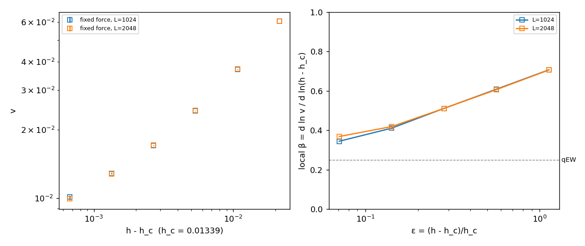
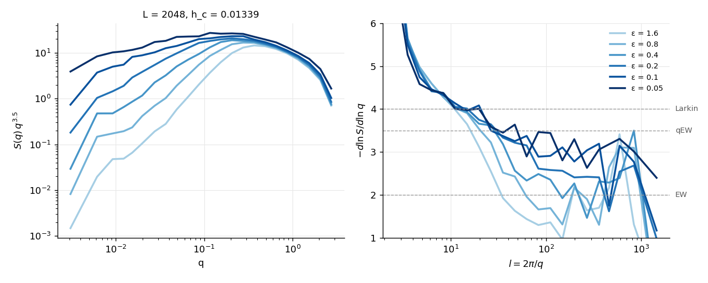

# Velocity-driven and finite-velocity drivers

Branch `vdrive`. Two more drivers on top of the force-driven bisection of `main.cu`. They share
`misistema.h`, and with the new options left at their defaults the force-driven solver is
unchanged bit for bit.

| driver | build | dynamics | drive | measures |
|---|---|---|---|---|
| `main.cu` | `make` | VMC, metastable states | uniform h, bisected | h_d per sample, critical wall |
| `main_vd.cu` | `make vd` | VMC, metastable states | spring advanced in steps dW (v → 0⁺) | F, avalanches S |
| `main_vdyn.cu`, H0 > 0 | `make vdyn` | explicit Euler, T = 0 | spring at velocity v | ⟨F⟩(v), fluctuations, moving walls |
| `main_vdyn.cu`, H0 = 0 | `make vdyn` | explicit Euler, T = 0 | uniform h | v(h), moving walls |

Only macroscopically flat walls are covered (no tilt). The SYCL port (`docs/intel_gpu.md`) covers
`main.cu` only. Build options (`AMPDIS`, `AX`, `AY`, ...) are those of `make`, with
`VD_TARGET` / `VDYN_TARGET` naming the binaries.

## 1. Method
- **Spring.** A Zeeman term with a gradient, h(y) = h_u − H0 (y − W), ties the wall to the
  well center W. A wall at mean height u feels the drive F = h_u + H0 (W − u): a spring of
  constant 2H0 (the field pushes the wall with 2h per unit length).
  - The spring sets a mass length L_m = √(σ/2H0), with σ = 2√2/3 the wall tension for
    c = ε0 = 1: L_m ≈ 69, 125, 217 and 396 for H0 = 1e-4, 3e-5, 1e-5 and 3e-6.
  - The uniform part h_u keeps the wall near W instead of h_d/H0 rows behind it.
- **Imposed velocity.** W advances, either in steps dW with full relaxation in between
  (quasi-static) or as W = W₀ + vt. In the frame of the wall this is the disorder travelling
  backwards, r(x, y + vt).
- **Conveyor belt.** The box follows the wall: `shift_rows(n)` moves φ by n rows, a multiple of
  32, and adds n to the row offset at which the disorder is read. The disorder is a function of
  the lab row, so the wall can travel without limit in a box of fixed height Ly.
- **Mean wall position.** u = (area with φ > 0)/L − ½, in the lab frame, continuous across
  shifts.
- **Relaxation of the spring.** The mean drive relaxes in τ ≈ 1/(μ H0), with μ = dv/dh (2.12
  for a clean wall, smaller with disorder): τ ≈ 4700 at H0 = 1e-4. A run must last several τ,
  or start near the expected drive (`--F0`).
- **When the two ensembles agree.** At finite v the moving wall has a correlation length ξ_v
  that diverges as v → 0. Imposing v with a spring should give the same ⟨F⟩ as the h that
  produces v at fixed force once L_m ≫ ξ_v and L ≫ ξ_v.
- **Quasi-static spring vs bisection.** ⟨F⟩ averages over the sequence of metastable states,
  whereas h_d is the strongest pinning met over a path (§1 of `analysis_math.md`): the two
  agree only in the limit H0 → 0, L → ∞.

## 2. Code
- **`misistema.h`** (all changes opt-in):
  - `Drive {h, grad, center, row_offset}` replaces the uniform field in `velocityop`,
    `vmcop` and `vmc_tiles_kernel`. `Drive::field(y)` returns h exactly when `grad == 0`.
  - `site_disorder(x, y, ...)` takes the lab row `y + row_offset`, with a 64-bit site index
    (high word mixed into the counter), so long runs never repeat disorder.
  - `set_field_gradient(H0, y_c)` (refuses a tilted box), `set_row_offset`, `shift_rows`,
    `positive_area_lab`.
  - `euler_step(dt)`: φ ← φ + dt·(force of `velocityop`), the same force the VMC zeroes.
  - `print_rows_binary(file, y0, n)`: a band of rows, for long series of snapshots.
- **`main_vd.cu`**, quasi-static:
  `./phi4vmc_vd L Ly H0 h_u dW nsteps seed [--F0 f] [--recenter d] [--dump-every k] [--row-offset R]`.
  Writes `vd_seed<s>.dat`: `step W u F S sweeps converged`, with S the avalanche size (change of
  u) and `converged` = 0 if a step hit the sweep cap. `--dump-every` saves
  `vdfield_step<k>_seed<s>.bin`.
- **`main_vdyn.cu`**, finite velocity:
  `./phi4vmc_vdyn L Ly H0 h_u v dt tmax seed [--tout t] [--F0 f] [--recenter d] [--row-offset R]
  [--dump-every k] [--dump-band B] [--dump-after t0] [--start-from file]`.
  - H0 > 0: `vdyn_v<v>_seed<s>.dat` with `t W u F`.
  - H0 = 0: fixed force h_u; v and `--F0` are ignored, and the output is
    `vdyn_h<h>_seed<s>.dat` with `t u`.
  - Snapshots `vdynfield_t<t>[_y<y0>]_seed<s>.bin`: the whole box, or with `--dump-band B` only
    the 2B rows around the wall, the first of them at lab row y0.
  - dt = 0.05 is safe (stable below ~0.19), and results do not change at dt = 0.025.
  - `--reflect-y` (also in `main_vd.cu`): reflecting y boundary (the neighbor across it is the
    site itself) instead of anti-periodic. Needed when deep trenches of the old phase are left
    behind (Δ = 1.0 near threshold, §6): once the conveyor brings one down to row 0, the
    anti-periodic seam nucleates a spurious domain of the new phase at the top row. Off by
    default; without it every output is unchanged bit for bit.
- **Analysis scripts** (`scripts/`):

  | script | input | output |
  |---|---|---|
  | `vdrive_stats.py` | `vd_seed*.dat` | ⟨F⟩, Var F, C(w), P(S) |
  | `vdyn_stats.py` | `vdyn_*_seed*.dat` | F(v) and v(h), transients flagged |
  | `vdrive_beta.py` | production tree | v(h), β, local β, equivalence against L_m |
  | `vdrive_sq.py` | snapshots of one condition | `Sq_L<L>.dat` (the format of `sq_regimes.py`) |
  | `vdrive_sq_plot.py` | several `Sq_L<L>.dat` | S(q) q^3.5 and local slope against l |
- **Cluster production:** `make_vdyn_jobs.py` writes job lists, `slurm_vdyn.sh` runs them as a
  resumable array. See `docs/plans/vdrive_beta.md`.

## 3. Validation
On vader (GTX 1080), 2026-10-22/23.

- **Regression.** The force-driven solver of the branch gives the same h_d and critical field,
  bit for bit, as `main`: L = 256, Δ = 0.3, 3 seeds, 1×1 and 8×1 blocks. Each later change
  (Euler, fixed-force mode, band dumps) left the earlier quasi-static and Euler outputs
  bit-identical.
- **Clean lattice (Δ = 0).**
  - *Quasi-static:* the wall advances one row at a time at F = 0.0029, the Peierls–Nabarro
    threshold; bisection gives 0.00288.
  - *Euler:* F ≈ v/2.12 (the continuum φ⁴ mobility) plus a lattice correction of 0.001–0.003,
    the same for dt = 0.05 and 0.025 to six digits.
- **Conveyor belt.** Ly = 512 and 2048, aligned with `--row-offset`, give bit-identical F and u
  at every output, both quasi-static (1001 steps) and with Euler (2001 outputs).
- **No-passing.** S ≥ 0 at every quasi-static step, and every step converged.
- **Euler towards the quasi-static limit** (Δ = 0.3, L = 256, H0 = 1e-4). ⟨F⟩ = 0.0205, 0.0133
  and 0.0114 for v = 0.03, 0.01 and 0.003, approaching the VMC value 0.0105.
- **Ensemble equivalence, clean lattice.** Imposing v = 0.05 gives ⟨F⟩ = 0.02535 (H0 = 1e-3) and
  0.02526 (H0 = 1e-4); the fixed force h = 0.02535 gives v = 0.0502 (0.4 %).
- **Ensemble equivalence with disorder** (Δ = 0.3, L = 256, 3 seeds; fixed force first, then the
  same v with the spring, starting at F0 = h and running at least 8/(2.5 H0)):

  | v | h (fixed force) | ⟨F⟩, H0 = 1e-4 | ⟨F⟩, H0 = 3e-5 |
  |---|---|---|---|
  | 0.0923 | 0.05 | 0.04993 | 0.04994 |
  | 0.0501 | 0.03 | 0.02995 | 0.02994 |
  | 0.0274 | 0.02 | 0.01999 | 0.01994 |
  | 0.0132 | 0.015 | 0.01468 ± 0.00015 | 0.01485 ± 0.00009 |

  For v ≥ 0.027 the two agree within 0.2 %. At v = 0.013 the spring gives a lower drive, by
  2 % at H0 = 1e-4 and 1 % at H0 = 3e-5: L_m is no longer much larger than ξ_v. At h = 0.013 the
  fixed-force wall stops in all 3 seeds.
- **Quasi-static spring vs bisection** (Δ = 0.3, L = 256, 3 seeds, steps 400–2000 of dW = 0.5):

  | H0 | L_m | ⟨F⟩ |
  |---|---|---|
  | 1e-4 | 69 | 0.01081 ± 0.00014 |
  | 3e-5 | 125 | 0.01189 ± 0.00018 |
  | 1e-5 (Ly = 2048) | 217 | 0.0126 ± 0.0001, not stationary |
  | bisection, square box | — | 0.01275–0.01280 |

  ⟨F⟩ rises towards h_d as L_m grows. At small H0 each avalanche moves the wall by hundreds of
  rows: the runs must be much longer, and Ly larger than the largest avalanche.

## 4. Performance
Euler, wall time per step, recentering and output included; band dumps cost nothing
measurable. Cluster: median over the 120 runs of the Δ = 0.3 production, per GPU model.

| GPU | L × Ly = 1024 × 512 | 2048 × 1024 | per site and step |
|---|---|---|---|
| GTX 1080 (vader) | 0.10 ms | 0.33 ms | 0.16–0.19 ns |
| RTX 3080 (node210) | 0.060 ms | 0.205 ms | 0.10–0.11 ns |
| RTX 3080 Ti (node212) | — | 0.172 ms | 0.082 ns |
| A10 (node213) | 0.068 ms | 0.261 ms | 0.12–0.13 ns |

Every site is updated every step, so the cost scales with L·Ly and the memory bandwidth. A run
that moves the wall N rows takes N/(v·dt) steps: at Δ = 0.3, L = 2048, 1600 rows took 29 min at
v = 0.010 and 2 min at v = 0.06 on an RTX 3080.

The quasi-static driver costs what the VMC relaxation costs (active tiles): one avalanche per
step, cheap away from the largest avalanches, and dominated by them as H0 → 0.

## 5. Results: Δ = 0.3, fixed force, L = 1024 and 2048
10 seeds per point, T = 0, h_c = 0.01339 (bisection, κ = 20, L = 8192), Ly = L/2. Each wall
travels 800 rows of transient and at least 800 measured rows. Cluster array 973476,
2026-10-24. Data in `data/vdrive_beta/` on the cluster, figures in `results/vdrive_beta/`.

| ε = h/h_c − 1 | h | v (L = 1024) | v (L = 2048) | local β (1024 / 2048) |
|---|---|---|---|---|
| 0.05 | 0.01406 | 0.01012 | 0.00993 | |
| 0.1 | 0.01473 | 0.01285 | 0.01281 | 0.34 / 0.37 |
| 0.2 | 0.01607 | 0.01708 | 0.01713 | 0.41 / 0.42 |
| 0.4 | 0.01875 | 0.02434 | 0.02441 | 0.51 / 0.51 |
| 0.8 | 0.02410 | 0.03712 | 0.03716 | 0.61 / 0.61 |
| 1.6 | 0.03481 | 0.06058 | 0.06061 | 0.71 / 0.71 |

Errors from the spread between seeds are 1e-5–1e-4. The local β is d ln v/d ln(h − h_c) between
each row and the one above.

- **No finite-size effect** in this range: the two L agree within 0.5 %, 2 % at ε = 0.05.
- **Not yet critical.** The local β falls steadily, 0.71 → 0.35, with no plateau. A single power
  law does not describe the range: with h_c fixed it gives β = 0.52, and with h_c free it moves
  h_c down to 0.0120–0.0122 and gives β ≈ 0.72. Neither is the exponent. The critical regime,
  where β → 0.25 (qEW) is expected, lies at ε < 0.05.
- **S(q) of the moving walls** (5 seeds × 20 snapshots of the second half of each run):

  

  At l ≈ 10–20 the slope is the Larkin 4 at every ε. Above, it falls towards the fast-flow EW
  value 2, and it drops below 3 at l ≈ 25, 30, 40 and 70 for ε = 1.6, 0.8, 0.4 and 0.2. At
  ε = 0.1 and 0.05 it stays at 3–3.5 (qEW) up to l ~ 1000. That is ξ_v growing towards the
  threshold, and it agrees with v(h): the walls are critical over most of L only at ε ≲ 0.1.

## 6. Δ = 1.0 pilot (one seed, L = 1024, Ly = 1024)
h_d(Δ = 1.0) = 0.0663 (bisection, `data/sweep_v2`, 30 seeds, the same at L = 1024 and 2048), and
l_o ≈ 100 there: critical walls have overhangs at all large scales. Here 1 + r reaches 0.

| ε | v | v/h_c | v/h_c at Δ = 0.3 | width w | multivalued columns |
|---|---|---|---|---|---|
| 0.05 | 0.0456 | 0.69 | 0.75 | 30–45 | 0.7 % |
| 0.2 | 0.0789 | 1.19 | 1.28 | 14–18 | 0 |
| 0.8 | 0.175 | 2.64 | 2.77 | 3–4 | 0 |

- **v/h_c against ε nearly collapses** between Δ = 0.3 and 1.0 over this range.
- **The moving walls are elastic.** No bubbles, no domains of the new phase nucleated ahead of
  the wall, and almost no overhangs. Overhangs should appear once ξ_v ≳ l_o ≈ 100, at smaller ε.

## 7. Open
- Fixed force closer to the threshold, and the velocity-driven stage (`docs/plans/vdrive_beta.md`)
  for v below the fixed-force range, where sample-to-sample fluctuations of the threshold stop
  fixed-force walls.
- Δ = 1.0 down to ε ~ 0.01, where ξ_v > l_o: does β change, do the moving walls develop
  overhangs?
- Thermal noise.
