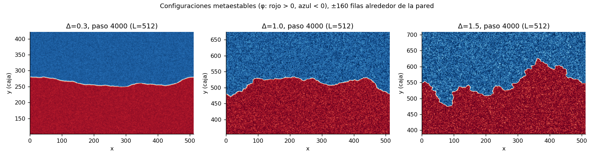
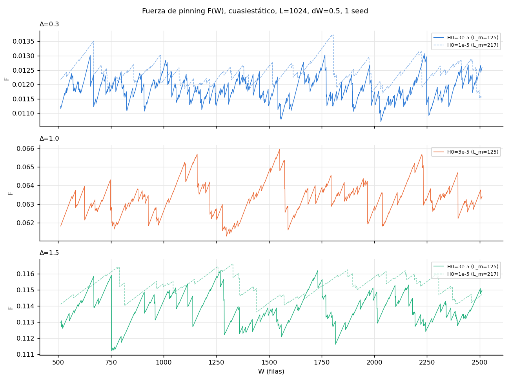
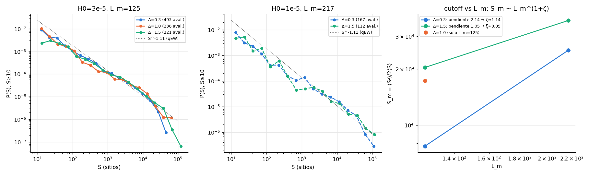
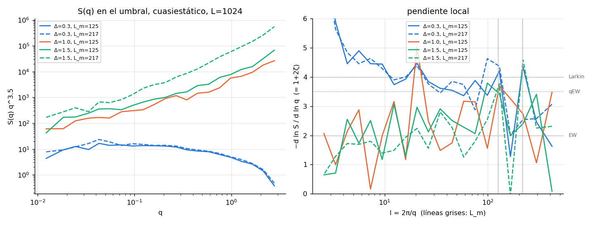
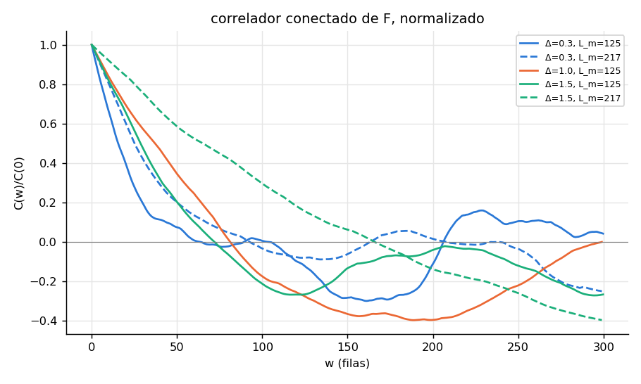
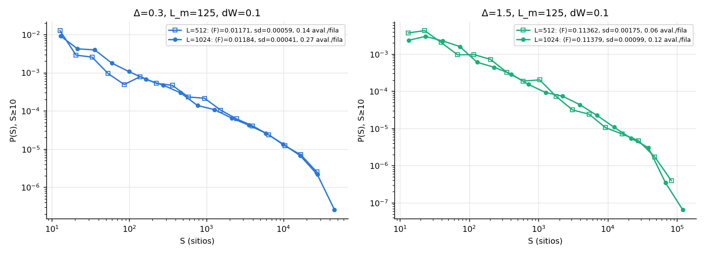
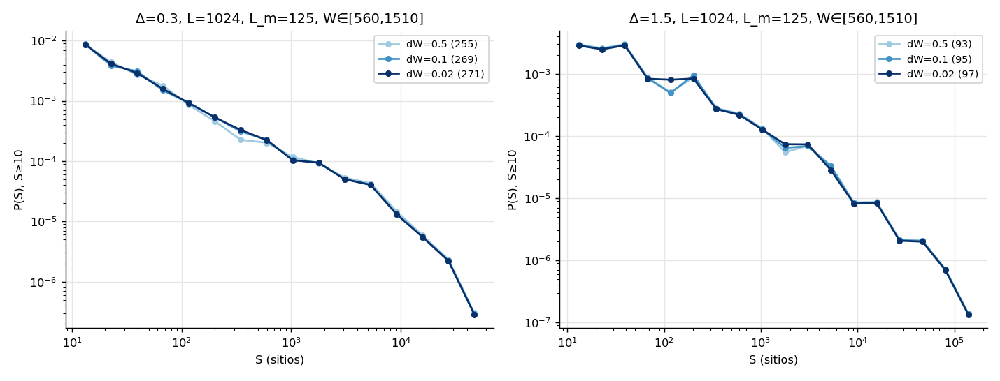

# Quasi-static pilot (2026-10-29)

These are pilot runs of `main_vd.cu` (v → 0⁺, parabolic well), made before the Δ sweep of
[`docs/plans/qs_delta_sweep.md`](../../docs/plans/qs_delta_sweep.md). Each condition is one seed.

The runs:
- L = 512 on vader (GTX 1080);
- L = 1024, Ly = 1024 on the cluster (RTX 5070 Ti);
- all with `--reflect-y`, and with H0 = 3e-5 (L_m = 125) unless stated otherwise.

The figures come from `python3 scripts/pilot_qs_plots.py`, which reads `data/pilot_qs` and
`data/pilot_qs_L1024`. The data are not in git; on the cluster they are in `data/pilot_qs`.

Colours: Δ = 0.3 blue, Δ = 1.0 orange, Δ = 1.5 green. Solid lines are L_m = 125, dashed lines L_m = 217.

## Metastable configurations (L = 512)

The wall goes from smooth at Δ = 0.3, to rough with steps at Δ = 1.0, to very irregular at Δ = 1.5, with
~150-row tongues and bays.

None of the dumped configurations has detached domains (`scripts/bubbles.py`).

## Pinning force F(W) (L = 1024, dW = 0.5)

- At Δ = 0.3 there are many small, frequent drops.
- At Δ ≥ 1 there is stick-slip: long linear loading stretches, with the spring's slope, and no motion
  during them, then large drops.
- ⟨F⟩ rises as the spring softens (L_m = 217).

## Avalanches

P(S) for S ≥ 10 roughly follows S^-1.11 (qEW) up to the cutoff.

The cutoff S_m = ⟨S²⟩/2⟨S⟩ ~ L_m^{1+ζ}:

| Δ | slope | ζ |
|---|---|---|
| 0.3 | 2.14 | ≈ 1.1 (elastic) |
| 1.5 | 1.05 | ≈ 0 |

These come from only two L_m and 100–500 avalanches each, so they are a hint to be tested in production.

τ itself cannot be told apart between Δ with this statistics. Maximum-likelihood fits of a truncated
power law give τ between 0.8 and 1.1 for every Δ. The value depends more on the fitting window than on
Δ, with errors of 0.05–0.1 from 40–300 avalanches per window. Windows that reach S_m give τ < 1
because they include the bump before the cutoff.

Two other features are robust:
- 80–90 % of all events are flips of 1–9 sites, at every Δ.
- At Δ = 1.5, P(S) is flatter between S = 10 and 100.

For production: telling τ apart needs ~10⁴ avalanches with S ≥ 10 per point, and a collapse in S/S_m
rather than a fixed window.

## S(q) at threshold (L = 1024)

S(q) comes from the 19 dumped metastable configurations of each run, through `scripts/vdrive_sq.py`
(univalued profile of the φ = 0 contour).

- At Δ = 0.3, S(q) q^3.5 is flat between l ≈ 10 and L_m: the local slope is ≈ 3.5–4 (qEW/Larkin).
- At Δ ≥ 1 the slope drops to ~2–3 up to L_m (ζ ≈ 0.5–1). This agrees with the moving walls at Δ = 1
  ([`../vdrive_D1.0`](../vdrive_D1.0)) and goes the same way as the cutoff exponent.

It is noisy: one seed and 19 configurations per run.

## Force–force correlator

- At Δ = 0.3, C(w)/C(0) decays over 60–100 rows.
- At Δ ≥ 1 it turns clearly negative, down to about −0.4. This is the stick-slip signature: a large
  drop is followed by a long loading stretch.
- At Δ = 1.5 it widens strongly from L_m = 125 to 217.

## L = 512 vs L = 1024 at equal L_m

- P(S) and ⟨F⟩ coincide, so the cutoff is set by L_m and not by L.
- sd(F) ∝ L^{-1/2}.
- The number of avalanches per row of W doubles from L = 512 to L = 1024.

## Driving step dW

Over the same stretch of W (rows 560–1510):
- dW = 0.5, 0.1 and 0.02 give the same ⟨F⟩, sd(F), S_m and largest avalanche.
- dW = 0.5 merges about 4–6 % of the small avalanches.

At Δ = 1.5 the number of steps that hit the sweep cap without converging grows as 1/dW (3, 11 and 41
per ~1000 rows). They all have S = 0. They look like the saddle-node bottleneck when W lands just
below an avalanche trigger: the avalanche is counted on the next step, so this costs time but does
not change S.
