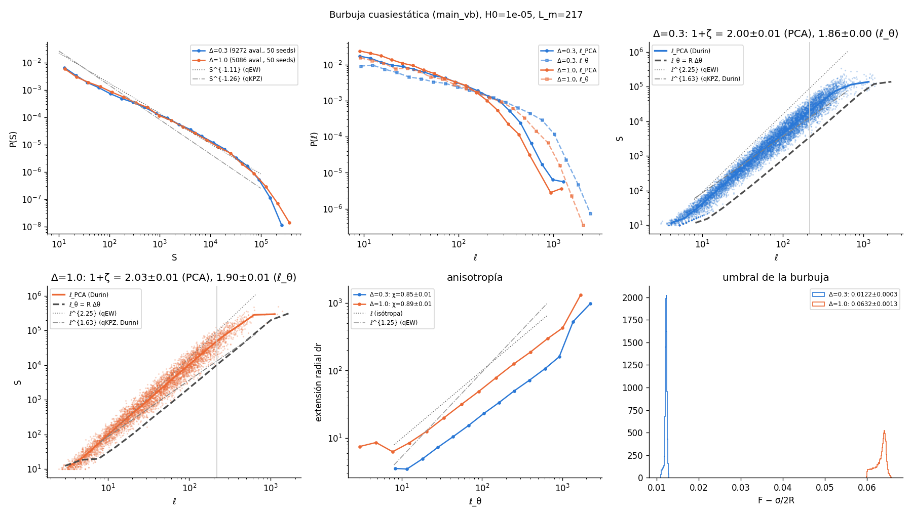
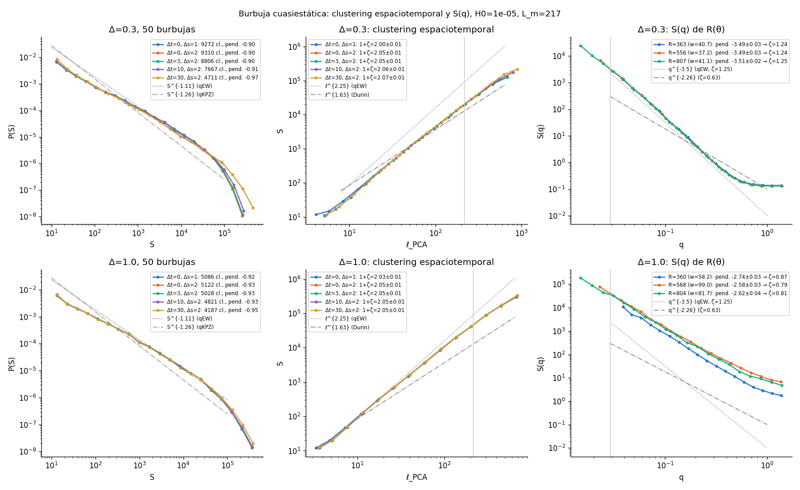

# Bubble with a larger L_m: L = 2048, H0 = 1e-5 (L_m = 217) (2026-11-05)

These runs use R0 = 250, Re = 960 and dA = 1024, with 50 seeds at each of Δ = 0.3 (h_u = 0.015,
F0 = 0.013) and Δ = 1.0 (h_u = 0.066, F0 = 0.062). They ran on rocks (compute-6-4 and compute-6-5,
`~/Codigos/bubble_vb/data/vb_big`), taking ~10–18 min per bubble. All 100 reached Re. The figures and
numbers come from
`python3 scripts/bubble_aval.py data/vb_big --out results/vb_big --H0 1e-5` and
`python3 scripts/bubble_cluster.py data/vb_big --out results/vb_big --H0 1e-5 --radii 350,550,800 --clusterings 0:1,0:2,3:2,10:2,30:2`.

H0 is 1e-5 rather than 3e-6 because the bubble is stable only for R > L_m. With L_m = 396, a box of
2048 would leave almost no range of R.

The values at L_m = 125 come from [`../vb_stats`](../vb_stats/README.md) and [`../vb_flip`](../vb_flip/README.md).

| | Δ = 0.3, L_m = 125 | Δ = 0.3, L_m = 217 | Δ = 1.0, L_m = 125 | Δ = 1.0, L_m = 217 |
|---|---|---|---|---|
| avalanches S ≥ 10 | 4657 | 9272 | 2048 | 5086 |
| F − σ/2R | 0.0117 | 0.0122 | 0.0621 | 0.0632 |
| 1+ζ, ℓ_PCA (Δt = 0) | 1.97 | 2.00 | 2.01 | 2.03 |
| 1+ζ, ℓ_PCA (Δt = 30, Δs = 2) | 2.03 | 2.07 | 2.03 | 2.05 |
| 1+ζ, ℓ_θ | 1.80 | 1.86 | 1.90 | 1.90 |
| χ (dr ~ ℓ_θ) | 0.82 | 0.86 | 0.88 | 0.89 |
| ζ, from S(q) | 1.26 | 1.24–1.26 | 1.00 → 0.84 | 0.87 → 0.79 |

- **Δ = 0.3:**
  - S(q) gives ζ = 1.25 (qEW) at R = 360, 560 and 800. The wall is qEW, independent of curvature.
  - The avalanche cloud with ℓ_PCA stays at 1+ζ ≈ 2.0. Going from L_m = 125 to 217 moves it by only
    +0.03, so it does not converge towards 2.25.
  - The PCA method on the avalanches of a qEW wall gives "ζ" ≈ 1.0–1.07, not 1.25.
  - Space-time clustering raises the exponent only slightly (≤ 0.07).
- **Δ = 1.0:**
  - S vs ℓ goes as ~ℓ^{2.25} below ℓ ~ 30 and bends to ~2 near L_m.
  - S(q) is not clean: lobes with overhangs give ζ_app ≈ 0.8. At R ≈ 800 only 4 seeds survive, since
    the lobes reach Re first.
- **P(S):** at both Δ the slope over the intermediate range is ~0.9–0.95, between the cut-off bump and
  S^{-1.11}. There is no S^{-1.26}.
- **For Durin et al.:** an isotropic, curved qEW wall analysed their way gives 1+ζ ≈ 2.0, not 1.63.
  Their 0.63 does not come from the analysis method or from curvature. To reach qKPZ something else
  is needed: anisotropy, as they argue, or creep dynamics.
