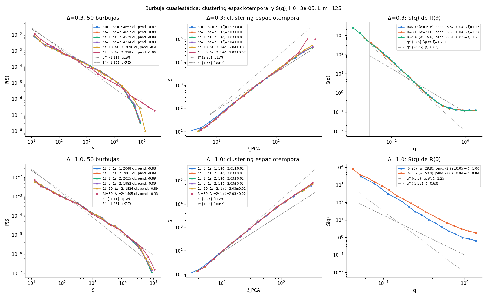

# Bubble: spatiotemporal clustering and S(q) of the wall (2026-11-04)

These are the same runs as [`../vb_stats`](../vb_stats/README.md): L = 1024, H0 = 3e-5 (L_m = 125),
R0 = 150, Re = 448, dA = 512, 50 seeds at each of Δ = 0.3 and 1.0. They were rerun with the flip map
`vbflip_seed<s>.bin`, which records for each site the step at which it became φ > 0. The data are in rocks
`~/Codigos/bubble_vb/data/vb_flip` and in `data/vb_flip` (not in git). The analysis is
`python3 scripts/bubble_cluster.py data/vb_flip --out results/vb_flip --H0 3e-5`, with the numbers in
[`bubble_cluster.txt`](bubble_cluster.txt).

## Spatiotemporal clustering

The clustering follows Durin et al.: two flipped sites go in the same cluster if they are at a distance
≤ Δs and flipped within Δt steps of each other. Δt = 0, Δs = 1 gives back exactly the quasi-static
avalanches of `vbaval`.

| Δ | Δt = 0, Δs = 1 | 0, 2 | 1, 2 | 3, 2 | 10, 2 | 30, 2 |
|---|---|---|---|---|---|---|
| 0.3: 1+ζ (ℓ_PCA) | 1.97 | 2.03 | 2.03 | 2.04 | 2.04 | 2.03 |
| 1.0: 1+ζ (ℓ_PCA) | 2.01 | 2.03 | 2.03 | 2.03 | 2.03 | 2.03 |

The fits use 8 ≤ ℓ ≤ L_m, with errors of ±0.01–0.02.

- Grouping successive avalanches does not change the exponent. Clusters spanning up to ~75 steps
  (Δ = 0.3, Δt = 30) keep the same S ~ ℓ^{2.0} relation.
- P(S) barely changes. With large Δt, a tail of percolated clusters appears.
- The time window of the experiment cannot, on its own, take 2.0 down to 1.63.

## S(q) of R(θ)

R(θ) is the outermost site of the bubble in each angular bin (~2 sites wide), at the step where the
mean R crosses 200, 300 and 400. The structure factor is S(q) = 2πR |ρ_n|² with q = n/R, and the fit is
S(q) ~ q^{-(1+2ζ)} over 2π/L_m < q < 2π/16.

| Δ | R ≈ 209 | R ≈ 305 | R ≈ 402 |
|---|---|---|---|
| 0.3: ζ | 1.26 ± 0.02 | 1.27 ± 0.02 | 1.26 ± 0.02 |
| 1.0: ζ | 1.00 ± 0.02 | 0.84 ± 0.02 | — |

- **Δ = 0.3:** the wall is qEW (ζ = 1.25) below L_m, independent of R, so curvature does not change
  the universality class. At large q there is a plateau at ~0.12, from lattice discretization.
- **Δ = 1.0:** S(q) is not a clean power law. The bubble grows in lobes with overhangs, R(θ) (the
  outer envelope) is not a single-valued function, and the apparent ζ falls as R grows.
- **Consequence for Durin et al.:** for the same Δ = 0.3 qEW wall, S(q) gives ζ = 1.26 while the
  avalanche cloud with their ℓ_PCA gives 1+ζ = 2.0, that is "ζ" = 1.0.
  - Measuring ζ from S ~ ℓ^{1+ζ} with PCA lengths underestimates it by about 0.25 here. Compact avalanches
    narrower than L_m have d_f ≈ 2, not 1+ζ.
  - The 0.63 of the experiment therefore cannot be read directly as qKPZ.
  - It has to be compared with its own S(q), if they have one.
