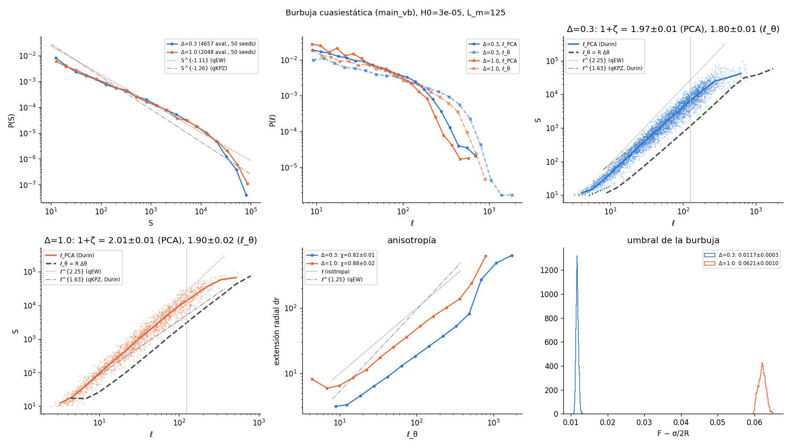
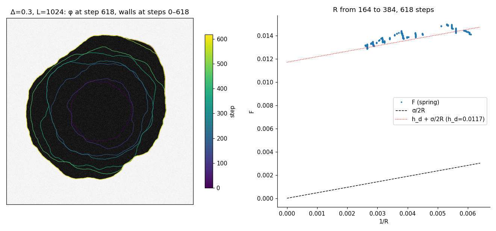
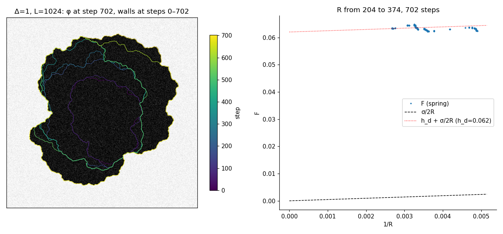

# Quasi-static bubble: avalanche statistics (2026-11-04)

These runs use `main_vb.cu`, a bubble held by a radial spring (the cone field h_u − H0 (r − R_W)). The
parameters are L = 1024, H0 = 3e-5 (L_m = 125), R0 = 150, Re = 448, dA = 512, with 50 seeds at each of
Δ = 0.3 and 1.0. They ran on rocks (compute-6-4, RTX 2080 Ti, and compute-6-5, RTX 2070), with the data in
`~/Codigos/bubble_vb/data/vb_stats` and a copy without dumps in `data/vb_stats` (not in git). The
figures come from `python3 scripts/bubble_aval.py data/vb_stats --out results/vb_stats` and from
`scripts/vb_snapshots.py` (seed 1). The fits are in [`bubble_aval.txt`](bubble_aval.txt).

The question is the experiment of Durin et al. (arXiv:2309.12898). There a bubble grows by creep, and
from S ~ ℓ^{1+ζ}, with ℓ from the principal axes of each cluster, they get ζ ≈ 0.63 and conclude qKPZ.

| Δ | avalanches S ≥ 10 | F − σ/2R | τ_MLE (10..S_m) | 1+ζ (ℓ_PCA) | 1+ζ (ℓ_θ = RΔθ) | χ (dr ~ ℓ_θ) |
|---|---|---|---|---|---|---|
| 0.3 | 4657 | 0.0117 ± 0.0003 | 0.87 | 1.97 ± 0.01 | 1.80 ± 0.01 | 0.82 ± 0.01 |
| 1.0 | 2048 | 0.0621 ± 0.0010 | 0.90 | 2.01 ± 0.01 | 1.90 ± 0.02 | 0.88 ± 0.02 |

The fits use 8 ≤ ℓ ≤ L_m.

- **Threshold:** F − σ/2R, with the Laplace pressure σ/2R (σ = 2√2/3) subtracted, matches the planar
  quasi-static ⟨F⟩ at the same Δ and H0.
- **P(S):** it follows roughly S^{-1.1} at both Δ, with no sign of the S^{-1.26} of qKPZ. As in the planar
  pilot, a window that reaches S_m gives τ_MLE < 1.
- **S vs ℓ:**
  - With the ℓ of Durin et al., 1+ζ ≈ 2.0 (ζ ≈ 1.0) at both Δ, the same as d_f in the planar pilot.
  - This is far from their 1.63 (ζ = 0.63), and below the 2.25 of qEW. At L_m = 125 the window
    8–125 is still contaminated by Larkin at small scales; see the planar sweep plan.
  - The isotropic φ⁴ bubble, analysed their way, does not give their exponent.
- **Anisotropy:** the radial extent grows as ℓ_θ^{0.82–0.88}.

**Snapshots:**
- Δ = 0.3: the bubble grows round and only slightly rough.
- Δ = 1.0: it grows by large lobes.
- In both, F follows h_d + σ/2R as R grows.

**Not done yet:** the spatiotemporal clustering of the paper (Δt, Δs = 2), which needs the sites of each
cluster (only summaries are written); S(q) of R(θ) from the dumps; larger L_m (L = 2048, H0 = 3e-6).
