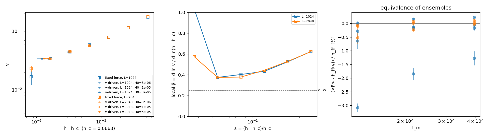
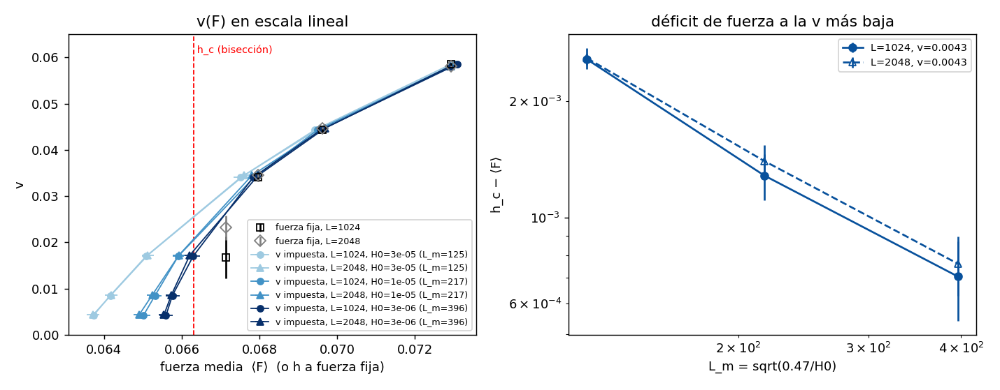

# Δ = 1.0: velocity-driven (stage vd) vs fixed force, L = 1024 and 2048, T = 0

The data are in `data/vdrive_D1.0` on the cluster (not in git). The fixed-force runs (stage ff) are SLURM
arrays 973944 and 975706, with the five seeds of 973944 that hit the anti-periodic seam rerun with
`--reflect-y`. Their analysis is in [`../vdrive_D1.0`](../vdrive_D1.0).

Stage vd is array 976215, built with:

```bash
make_vdyn_jobs.py vd --hc 0.0663 --extra-args --reflect-y ...
```

It has:
- v equal to the ff velocities for ε = 0.025–0.1, plus 0.5, 0.25 and 0.125 × v_min;
- H0 = 3e-5, 1e-5 and 3e-6 (L_m = 125, 217, 396);
- 5 seeds.

```bash
python3 scripts/vdrive_beta.py data/vdrive_D1.0 --hc 0.0663 --outdir results/vdrive_D1.0_vd
python3 scripts/vdrive_F_of_v.py data/vdrive_D1.0 --hc 0.0663 --outdir results/vdrive_D1.0_vd
```




## Results (`beta.txt`)

**Equivalence of ensembles.** Fixed force and velocity-driven agree within 0.6 % for v ≥ 0.034, and
the difference shrinks as L_m grows. At L = 2048 and L_m = 396 it is ≤ 0.1 %.

At v = 0.017 (ε ≈ 0.0125, where half the fixed-force seeds at L = 1024 stall), the velocity-driven
⟨F⟩ lies below the fixed-force field:

| L_m | 125 | 217 | 396 |
|---|---|---|---|
| ⟨F⟩ below h_ff | 3.1 % | 1.8 % | 1.3 % |

**Below h_c.** The slowest imposed v (0.004 and 0.0085) move steadily with ⟨F⟩ below the bisection
h_c = 0.0663. F(v → 0) rises towards h_c as the spring softens, with h_c − ⟨F⟩ ∝ L_m^{-1.1} (−1.12 at
L = 1024, −1.06 at L = 2048).

**L does not matter at equal L_m.** At equal H0, L = 1024 and 2048 give the same ⟨F⟩ within errors
at every v: the velocity-driven results depend only on L_m.

**β.** The local β of the fixed-force curve is ≈ 0.37–0.38 at ε = 0.025–0.05, far from qEW (0.25).
Power-law fits of v(⟨F⟩) per H0 with a free threshold give no stable β (0.43–0.76).
